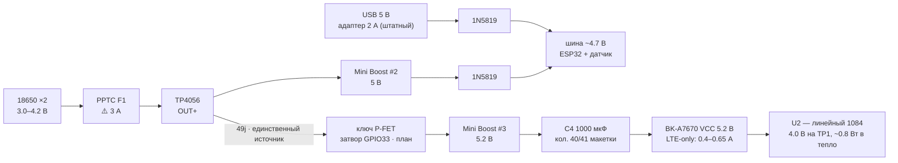
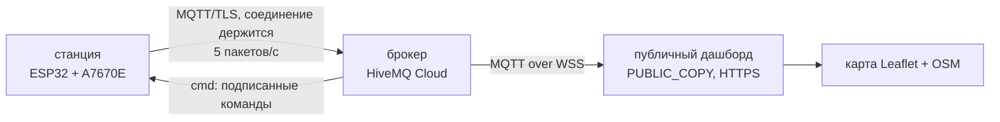

# Задача 10: 4G/GPS-модуль A7670E — встроить и вывести координаты на карту

## Промпт для новой сессии
```
Читай tasks/10-a7670e-4g-gps.md и выполни задачу шаг за шагом.
Источники истины: CLAUDE.md, bom-photos.md, wind-station-assembly.md.
Шаги 0a и 0b ПРОЙДЕНЫ 2026-08-16 — заново их не делать, результаты записаны в файле.
GNSS есть, координаты сняты, сеть работает.
⛔ Сначала tasks/11 (питание): станция не отвечает, банка в нуле — мерить нечем.
После 11 начинать с шага 1 (питание модема).
Перед шагом 1 прочитать §Питание целиком — там пересчитанная арифметика,
а не прикидки: старая версия документа предлагала схему, которая не работает.
Перед шагом 3 прочитать §Архитектура и §Холодный старт: канал изменён — постоянный
MQTT/TLS в пределах сеанса вместо POST раз в 5 минут (ресерч v4, 2026-08-17).
На шаге 1 добрать два долга шага 0: замер тока USB-ваттметром и шаг 0в (RF-соседство).
```

## Статус
- ⛔ **Блокер: задача 11.** Станция не отвечает, банка высажена в ноль, `IN+` TP4056
  не припаян, тумблер стоит после бустов. Пока это не починено, шаг 1 делать не на чем.
- Ресерч v1 — ✅ 2026-08-15.
- Ресерч v2 (пересчёт питания, замена стека на PPP, безопасность, дашборд) — ✅ 2026-08-16.
- Ресерч v3 (разбор фотографий — своих и вендорских: U2 линейный → питание пересчитано
  ещё раз) — ✅ 2026-08-16.
- **Ресерч v4 (транспорт данных переписан) — ✅ 2026-08-17.** Три находки, каждая меняет
  то, что было записано раньше:
  - **`esp-mqtt` уже лежит в SDK ядра** — внешних библиотек не нужно вообще, и клиент
    крутится в собственной задаче FreeRTOS, а не в `loop()`. См. §Софт;
  - **VPN-вариант мёртв на этом модуле**: A7670E рвёт PPP при UDP-трафике. §Безопасность;
  - **режим работы сеансовый, а не круглосуточный** (решено 2026-08-17): станция включается
    на время работы. Отсюда — постоянный канал 5 Гц вместо кадра раз в 5 минут,
    отказ от возврата диодного ИЛИ и новый главный риск: холодный старт.
- **Шаг 0 пройден 2026-08-16 в частях 0a и 0b — оба гейта задачи сняты на живом железе.**
  Не сделаны две вещи, обе переносятся на шаг 1: **шаг 0в** (RF-соседство — нужен модем
  рядом со станцией) и **замер тока USB-ваттметром** (вся арифметика §Питание пока
  только расчётная).
- Шаг 0a (GNSS по USB) — ✅ **2026-08-16. GNSS ЕСТЬ, и фикс получен.** Модуль `A7670E-MASA`.
  Координаты станции: **`50.510 N, 30.500 E`, высота 226.2 м** (3D fix за ~15 с,
  10 GPS + 7 BeiDou, HDOP 6.01 — точность десятки метров). Фикс дала **только антенна,
  вынесенная на улицу**: в помещении и на подоконнике его нет ни за пять минут, ни за
  двенадцать. Полный вывод и разбор — в §Шаг 0a, блоки «Результат» и «Фикс получен».
- Шаг 0b (сеть по USB) — ✅ **2026-08-16. Данные ходят, тариф не привязан.** APN
  `internet.mnc003.mcc255.gprs`, оператор 255-03, `AT+CNMP=38` пережил перезапуск.
  Две поправки к плану: **band плавает B1 ↔ B7** (RF-риск реален) и **`AT+CLTS` нет —
  время включается `AT+CTZU=1`**. Разбор — в §Шаг 0b, блок «Результат».
- Шаг 0в (RF-соседство) — ⏳ **не сделан.** На шагах 0a/0b модем лежал отдельно от станции,
  на USB ноутбука, так что мерить просадку WiFi и сдвиг нуля АЦП было не на чем.
- ⚠️ **Открытый хвост шага 0:** модуль дважды перезагрузился сам, питаясь от USB ноутбука
  (порт исчезал, `CGNSSPWR` сбрасывался). Это ровно тот симптом, который §Шаг 0b называет
  признаком нехватки питания. На штатных 5.2 В убедиться, что ушло.
- Железо: модуль и обе антенны на руках. **SIM-карта уже вставлена** (2026-08-16).
- Схема разводки под шаги 1–2 — ✅ 2026-08-16, **действующая версия `wiring-v6.html`**
  («Компакт-1», в корне, SVG инлайном; генераторы — `images/gen_wiring_v6_svg.py` →
  `images/wiring_v6.svg` → `images/build_wiring_v6.py`).
  - **v6 «Компакт-1»** — модуль садится **прямо на макетку**, штырями CN101 в ряд `a`,
    колонки **36–42**; переходной планки нет. Свес платы 37×37 уходит вверх за верхние рельсы
    и за край макетки; ряды `b`–`e` под ним остаются рабочими. C4 1000 мкФ переехал на плату
    (кол. **40/41**), C1 — с 39/41 на **43/44**. Диодное ИЛИ модема **снято**, буст №3 кормится
    только с `OUT+` TP4056. С макетки уходят **три** провода: `49j` → ключ → B3 IN+, `45i` →
    земля блока и один обратно в кол. 40 (5.2 В). Земля модема — **перемычка `41b` → `44b`**
    на самой макетке. Проводов к самому модему нет вовсе.
  - ⚠ **Штыри CN101 распаяны со стороны наклейки** (на обороте пайка срезана заподлицо —
    видно на `images/skins/photo_2026-08-15_20-44-*.jpg`), поэтому модуль ложится
    **наклейкой вниз**. Опознавать контакты надо **по буквам шелкографии — цифр у пятаков
    нет вовсе**: `S`·`G`·`V`·`K`·`T`·`R`·`G`, и последняя `G` стоит вплотную к **micro-USB**.
    Вдоль колонок это читается от разъёма: **кол.36 = `G` (контакт 7)**, 37 = `R`, 38 = `T`,
    39 = `K`, 40 = `V`, 41 = `G`, 42 = `S`. Наверх смотрят SIM-держатель и обе косички u.FL,
    а **micro-USB уходит вниз**: он на том же ребре, что гребёнка, и повисает над кол. 33–35
    на высоте ~4 мм — кабель в него, не сняв модуль, не воткнуть.
  - **v5** (`wiring-v5.html`, генераторы `*_v5_*`) — предыдущий вариант, оставлен для сравнения:
    модем на весу, своё диодное ИЛИ на двух Шоттки 3 А, пять проводов к CN101, три точки
    на макетке (`37j`, `49j`, `45i`). К исполнению **не берётся**.

## Цель
Добавить к станции 4G-аплинк и GPS, вывести координаты на дашборд с картой.
Побочная цель, ради которой всё и затевается: **станция на мачте/даче, без домашней сети,
остаётся видимой** — сейчас `HAS_HOME_NETWORK 0` означает полную изоляцию.

> ⚠️ **Честная оговорка к этой цели, которой не было в v1.** Сценарий «станция на мачте»
> упирается не в связь, а в питание. По расчёту в `wind-station-assembly.md` станция ест
> ~190 мА при 4.7 В (0.89 Вт) и живёт от двух LG HG2 **19–21 час**. Модем добавляет
> ~0.24 Вт (см. §Энергобюджет) — автономка падает до ~16 часов, то есть на 21%, а не «в разы».
> Но и 21 час, и 16 — одинаково бесполезны для мачты без розетки. **4G не решает задачу
> автономности и не ухудшает её принципиально.** Если станция реально уедет на мачту,
> раньше 4G нужна отдельная задача про питание: солнечная панель либо deep sleep.
> Пока станция стоит у розетки, 4G — это резервный канал и GPS, а не автономность.

### Уточнение к цели от 2026-08-17: режим сеансовый, а требование к темпу — жёсткое

Два ответа, полученных при пересмотре архитектуры, и оба меняют расчёты.

1. **Станция не работает круглосуточно.** Она включается на время работы, между сеансами
   питание снято. Значит месячный трафик и автономка перестают быть аргументами — считать
   надо на час эфира, — а вместо них главным риском становится **холодный старт**
   (см. одноимённый раздел): каждое включение стоит ~25–45 с до первого кадра в браузере,
   и этот штраф платится не раз в месяц, а каждый сеанс.
2. **«Раз в 5 минут» отклонено.** Удалённый дашборд должен выглядеть так же живо, как
   локальный: **1–2 секунды, а не минуты.** Тариф безлимитный, так что упор здесь не
   в гигабайты, а в задержку сети и в ток модема. Отсюда постоянно открытый канал
   и темп 5 пакетов в секунду — обоснование и арифметика в §Архитектура.

---

## Железо: что именно куплено

**Плата BK-A7670 V1**, производитель `www.and-global.com`.
Модуль **SIMCom A7670E**, P/N `S2-10F8H-Z333L`, SN `<SN>`, IMEI `<IMEI>`,
сертификат `CCAH23Y00011T5`. Всё сверено с наклейкой по снимкам 2026-08-16 — сходится
полностью, включая маркировку патч-антенны `1594P-C`.

> На шелкографии самой платы написано **`BK-7670 V1`, без буквы `A`** — так же и на снимках
> вендора. Мануал и каталоги при этом называют её `BK-A7670`. Искать документацию нужно
> по варианту с `A`, иначе поиск по надписи на плате ничего не находит.

Антенны в комплекте — две:
- плёночная LTE (в разъём **J1**)
- керамический патч «1594P-C» на 1575 МГц — это **GPS**, а не диверситивная LTE (в разъём **J2**)

Мануал платы: <https://manuals.plus/and/bk-a7670-4g-pcie-module-manual>
(оригинал PDF на `img.yfisher.com` отдаёт 403 при автозагрузке — открывать браузером;
текстового слоя в PDF нет, там картинки, автоматически он не парсится).

### Разъём CN101 — 7 контактов, шаг 2.54 мм

Гребёнка на плате одна и ровно на 7 контактов (сверено с железом 2026-08-15) — то есть это
и есть CN101 из мануала, других разъёмов искать не нужно. В мануале контакты пронумерованы
с нуля, здесь — с единицы; порядок тот же.

| # | Имя | Шелкография | Назначение |
|---|-----|-------------|------------|
| 1 | SLEEP | `S` | режим сна, заведён на DTR модуля через Q4. Не подключаем — см. §Энергобюджет |
| 2 | GND | `G` | земля |
| 3 | **VCC** | `V` | питание, **5.0–10 В (рекомендовано 5.0), обеспечить 2 А** |
| 4 | PWRKEY | `K` | вкл/выкл, **уже прижат к GND через R104**. Не подключаем |
| 5 | **TXD** | `T` | выход модуля, **3.3 В TTL** → на RX ESP32 |
| 6 | **RXD** | `R` | вход модуля, **3.3 В TTL** ← с TX ESP32 |
| 7 | GND | `G` | земля |

> **Как не перепутать сторону.** Цифр у пятаков на плате нет — только эти буквы, и порядок
> вдоль ребра `S`·`G`·`V`·`K`·`T`·`R`·`G`. Надёжный якорь — **micro-USB: он на том же ребре,
> и второй `G` (контакт 7) стоит вплотную к нему**. Ошибка на 180° подаёт VCC на TXD, поэтому
> до подключения питания **прозвонить оба крайних контакта на GND**: звониться накоротко
> обязан только тот, что у разъёма. Если звонятся оба или ни одного — не собирать,
> разбираться.

Используем четыре контакта из семи: VCC, TXD, RXD и один GND. SLEEP и PWRKEY остаются
не подключены — модуль стартует сам, а спать мы его не укладываем.

### Что ещё есть на плате (уточнено по мануалу 2026-08-16)

- **CN2 — держатель nano-SIM.** В v1 документа было написано «слот под micro, скорее всего
  нужен переходник» — **это была ошибка**, слот штатно nano. Переходник не нужен, карта
  уже стоит. Держатель — откидной, с надписями `OPEN` / `LOCK` на крышке: крышка сдвигается
  в сторону `OPEN`, поднимается, карта ложится в рамку, крышка закрывается и сдвигается
  к `LOCK`. Рядом шелкография `SIM1`; посадочное место `SIM2` на плате есть, но **не распаяно**
  (плата разведена как двухсимочная, распаян один слот).
- **D5 — зелёный NET LIGHT.** Бесплатная диагностика, которой в v1 не было:
  **часто мигает = сеть не найдена, медленно мигает = регистрация прошла.** По нему видно
  состояние аплинка, не открывая ни Serial, ни AT-порт. При интеграции в корпус — вывести
  в поле зрения или хотя бы запомнить, где он.
- **CN1 — micro-USB**, USB 2.0 самого модуля. Питает ли VBUS плату — мануал молчит,
  схему `device.report` отдаёт по 403. **Проверяется опытом на шаге 0a**, см. там.
- **U2 — преобразователь питания** 5–10 В → VBAT модуля (~4.0 В). Именно из-за него
  плата просит 5 В и выше, хотя сам модуль A7670E питается от 3.4–4.2 В.
  **По фотографиям это линейный стабилизатор, а не понижающий преобразователь** — разбор
  и последствия ниже, в §Что видно на фотографиях платы. Последствия серьёзные, они
  переписывают арифметику §Питание.
- **TP1 — тестовая точка 4.0 В**, по мануалу платы. Это и есть выход U2, то есть VBAT модуля.
  **Единственный способ померить вольтметром, не проседает ли питание модуля под передачей** —
  на VCC этого не видно, там ещё стоит стабилизатор.
- Антенные разъёмы: **J1** = LTE, **J2** = GPS (в мануале помечен *Optional*),
  **J3** = BT (*Optional*). По снимкам нашей платы распаяны **J1 и J2, на месте J3 —
  голые пятаки**, и обе антенны из комплекта уже воткнуты. Прежняя запись «распаяны
  все три» была неверной; на задачу это не влияет — BT не используем.

### Что видно на фотографиях платы (разобрано 2026-08-16)

Два набора снимков, и различать их важно.

**Карточка товара (чужой экземпляр):** `images/skins/S1ee45f7…`, `S73257e41…` — плата крупно
с обеих сторон, `S15e41d54…` — BOARD OVERVIEW с таблицей обозначений, `S2bed1829…` —
DONGLE DIMENSION с размерами, `S3c510f06…` — состав комплекта. На наклейке модуля там IMEI
`<чужой IMEI>`, то есть сфотографирован **не наш** модуль.

**Наша плата:** `images/skins/photo_2026-08-15_20-44-21*.jpg` (весь комплект с подключёнными
антеннами) и `photo_2026-08-15_20-44-44*.jpg` (обе стороны крупно). Наклейка читается целиком
и сходится с записями: `P/N S2-10F8H-Z333L`, `SN <SN>`, `IMEI <IMEI>`,
сертификат `CCAH23Y00011T5`.

> На снимках **строки SN/IMEI и QR-код закрашены** (репозиторий публичный, а QR кодирует
> тот же IMEI). Сами значения нигде в git не лежат — если понадобятся, они на наклейке
> модуля и в ответе `AT+SIMCOMATI`.

> Разводка на обоих наборах одинаковая, поэтому выводы про схему платы (U2, TP1, пятаки)
> подтверждены **на своём железе**, а не только по чужим снимкам. Что фотографии по-прежнему
> **не** решают — какой кристалл внутри экранированного модуля. Вопрос GNSS закрывает
> только `AT+SIMCOMATI`.

**1. U2 — линейный стабилизатор. Это главная находка, и она меняет расчёт питания.**

И на снимке вендора, и на нашем `photo_…_20-44-44.jpg` U2 — корпус TO-252/DPAK с маркировкой
**`1084`** (полностью: `AII 1084 1703EG`). `1084` — это семейство `AMS1084/LD1084`,
регулируемый LDO на 5 А. Четыре независимых подтверждения, что это именно линейник,
а не понижающий DC-DC:

- **на плате нигде нет дросселя.** Ни одного, ни на одной из сторон — проверено по нашим
  же снимкам. Без дросселя импульсный понижающий преобразователь физически не работает;
- корпус DPAK с тремя выводами и теплоотводящей площадкой — типовой корпус этого LDO;
- `TP1 = 4.0 В` из мануала сходится с регулируемым 1084, задранным делителем на 4.0 В;
- **VCC минимум 5.0 В при выходе 4.0 В — это ровно окно паразитного падения LDO.**
  Понижающий DC-DC спокойно работал бы и от 4.5 В, и минимум в мануале стоял бы ниже.

Что из этого следует (арифметика — в §Питание, там цифры уже пересчитаны):

- **ток на входе платы равен току модуля, а не меньше него.** LDO не преобразует ток:
  сколько модуль взял по VBAT, столько же пришло по VCC. Расчёт v2, где пик делился
  на отношение напряжений, был оптимистичен;
- **разница напряжений уходит в тепло:** `(VCC − 4.0) × I`. При 5.2 В и 0.65 А это ~0.8 Вт
  на маленьком DPAK без радиатора — плата будет ощутимо горячей. **Тем более нельзя
  подавать разрешённые мануалом 10 В**: там же выйдет 3.9 Вт и микросхема уйдёт в тепловую
  защиту. Держаться нижнего края диапазона;
- **окно по напряжению узкое с обеих сторон.** Ниже ~5.1 В — LDO вываливается из режима
  и VBAT просядет; выше — лишний нагрев. 5.2 В остаётся правильным выбором, но проверять
  его надо **по TP1 под нагрузкой**, а не по входу.

**2. Гребёнка CN101 уже распаяна — паять ничего не надо.** На снимке нашей платы со стороны
модуля видна семиконтактная гребёнка 2.54 мм с торчащими штырями. Значит на CN101 садятся
обычные dupont-мамы, и отдельного шага «припаять гребёнку» в задаче не появляется.
Пятаки `G`/`T`/`R` (см. ниже) — наоборот, голые.

**3. Тантал `J477` подтверждён.** Жёлтый конденсатор рядом с U2 читается как `J477` = **470 мкФ**.
Это тот самый штатный запас на VBAT, о котором говорит §Питание. Он висит **после** линейного
U2 и входную просадку не компенсирует — потому и нужен свой 1000 мкФ на VCC.

**4. J3 (BT) не распаян ни на нашей плате, ни на вендорской.** u.FL стоят только на **J1 (LTE)**
и **J2 (GPS)**, на месте `BT` — голые пятаки. В прошлой записи по проекту значилось
«распаяны все три» — **это была ошибка, поправлено**. На задачу не влияет: BT не используем.

**5. Обе антенны уже подключены.** На снимке комплекта плёночная LTE сидит на J1 (серый коаксиал),
патч 1575 МГц — на J2 (чёрный). Требование «антенны подключить до подачи питания» из шага 0a
на нашем экземпляре уже выполнено — но перед включением всё равно взглядом проверить,
что оба u.FL защёлкнуты (они отходят от натяжения провода).

**6. Второй ряд контактов `G` `T` `R` у нижнего края.** Виден и на фото вендора, и на нашем,
и на чертеже размеров — три круглых пятака отдельно от CN101, **без гребёнки**. По буквам это
земля и ещё одна пара UART (скорее всего отладочный порт модуля). Назначение мануалом
не описано, **проверять прозвонкой**, но потенциально полезно: можно повесить USB-TTL
и смотреть AT-обмен, пока основной UART занят ESP32.

**7. Габариты для корпуса:** плата **37 × 37 мм**, крепёжное отверстие ⌀3 мм в одном углу,
шаг CN101 — 2.54 мм, длина гребёнки ~18.5 мм вдоль края. Это уже можно класть в раскладку
корпуса в `wind-station-assembly.md`; плюс место под два коаксиала u.FL и разнос антенн
(см. §RF).

**8. Комплект подтверждён снимком `S3c510f06…`:** плата + плёночная 4G/NB-антенна +
патч-антенна GPS. Подпись продавца — «**CAT1 A7670E LTE+GPS version support WiFi scan**».

### Три вывода, которые определяют интеграцию

- **Преобразователь уровней НЕ нужен.** Мануал прямо: «TXD/RXD are 3.3V TTL level which can be
  directly connected with 3.3V MCU». Не спутать с голым модулем A7670E — у того UART 1.8 В,
  и половина интернета пишет про уровни именно о нём.
- **Питание от шины станции невозможно.** VCC требует 5.0–10 В, а шина даёт ~4.7 В — ниже
  минимума. Буст №1 (12 В для датчика) — выше максимума. Нужен свой источник, см. §Питание.
- **Модуль стартует сам** при подаче VCC, потому что PWRKEY уже на земле через R104.
  Отдельный GPIO под PWRKEY не нужен. Обратная сторона: **программно выключить или
  перезагрузить модуль нельзя** без резки R104 — только снятием VCC. См. §Аварийный ресет.

---

## Открытый вопрос: есть ли GNSS в этом SKU — ✅ ЗАКРЫТ 2026-08-16

> **Ответ: GNSS есть, и он работает.** Модуль оказался `A7670E-MASA` — третий суффикс,
> которого нет ни в одном публичном каталоге, и он **с GNSS**. Не просто отвечает на
> команды: с антенной на улице получен полноценный 3D-фикс за ~15 с —
> `50.510 N, 30.500 E`. Разбор ниже оставлен как есть: он объясняет, почему вопрос
> вообще стоял, и его ловушки (`CGNSSPORTSWITCH`) подтвердились на живом железе.
> Фактический вывод команд — в §Шаг 0a, блок «Результат».

Мануал платы пишет «GNSS **optional**», и это не отписка. В v2 нашлось объяснение точнее,
чем «по линейке GNSS числится за G и SA»:

- **У самого A7670E есть две ревизии, и различаются они буквами в суффиксе:
  `A7670E-FASE` — с GNSS, `A7670E-LASE` — без GNSS.** Плата и корпус одинаковые,
  распаянный J2 ничего не доказывает.
- Наш P/N `S2-10F8H-Z333L` — внутренний заказной код SIMCom, по нему суффикс не читается
  ни в одном публичном каталоге. Разрешается только командой `AT+SIMCOMATI`.
- На GitHub issue ровно с этим симптомом: у людей на A7670E **все** GNSS-команды
  (`AT+CGNSSPWR`, `AT+CGNSSMODE`, `AT+CGPSHOT`, `AT+CGNSSPORTSWITCH`) отвечают `ERROR` —
  <https://github.com/Xinyuan-LilyGO/LilyGo-Modem-Series/issues/327>. Мейнтейнеры в треде
  не ответили; вердикт сообщества — куплен вариант без GNSS-кристалла.

**Команды в v1 были названы неточно.** Правильная последовательность для A76XX:

```
AT+CGNSSPWR=1        ← включить GNSS. Ждать URC «+CGNSSPWR: READY!», не просто OK
AT+CGNSSINFO         ← мульти-созвездие (GPS+GLONASS+BDS+Galileo) — брать эту
AT+CGPSINFO          ← только GPS; в A76XX тоже есть, но смысла брать её нет
AT+CGNSSPORTSWITCH=<parsed>,<nmea>   ← куда уходит вывод: USB AT-порт или UART
```

Последняя — **отдельная ловушка именно для нас**: шаг 0 делается по USB, а работать
модуль будет по UART. По умолчанию разобранные координаты могут уходить в USB AT-порт,
и на UART мы не увидим ничего, решив, что GNSS сломался. Если на шаге 3 `AT+CGNSSINFO`
по UART молчит, а по USB отвечал — первым делом `AT+CGNSSPORTSWITCH`.

### Что добавили фотографии карточки товара

Аргумент в пользу того, что GNSS всё-таки есть, — но косвенный, и вопроса он не закрывает.

Подпись продавца к снимку комплекта: «**CAT1 A7670E LTE+GPS version support WiFi scan**».
То есть вендор продаёт эту позицию **именно как версию с GPS**, и кладёт в коробку патч-антенну
1575 МГц — что сходится с нашим комплектом один в один. Это заметно поднимает шансы против
исходной оценки «скорее всего LBS-версия».

Почему это всё же не доказательство: (а) IMEI на снимке не наш, то есть сфотографирован
другой экземпляр; (б) описания в карточках копируются между позициями линейки, и продавец
может не различать `-FASE` и `-LASE`; (в) распаянный J2 и антенна в комплекте — намерение
вендора, а не наличие кристалла. **Вердикт по-прежнему за `AT+SIMCOMATI` + `AT+CGNSSPWR=1`.**

Побочная находка — «**support WiFi scan**». У A76XX есть позиционирование по видимым
WiFi-точкам: модуль сканирует эфир и отдаёт список BSSID, координаты считает облачный сервис.
Это **третий** запасной путь к координатам, о котором v2 не знал, и в городе он точнее LBS
по сотам. Команду сверить по мануалу A76XX V1.09 — в разных прошивках она называется
по-разному. На мачте в поле смысла не имеет (чужих точек нет), но для отладки на столе
годится.

### Итого путей к координатам — четыре

1. **GNSS** (`AT+CGNSSPWR=1` → `AT+CGNSSINFO`) — точность метры. Проверяется на шаге 0a.
2. **WiFi scan** — десятки метров, только там, где есть чужие точки.
3. **LBS по сотам** (`AT+CLBS`) — ±300–1000 м.
4. **Константа в исходнике** — точность идеальная, обновляется руками раз в переезд.

Станция стационарная, так что даже вариант 4 задачу закрывает. Ветка «4G» от вердикта
по GNSS не зависит вообще.

> ⚠️ **Фикс на подоконнике ≠ фикс в корпусе.** Керамическому патчу 1575 МГц нужен вид
> на небо и опорная земля под ним, а корпус станции — **непрозрачный IP65, и стоит он внизу,
> в тени** (это решение уже записано в проекте). Даже если GNSS на шаге 0a заведётся,
> из закрытого чёрного бокса внизу фикса может не быть вовсе. Варианты: вынести патч
> под крышку/наружу вместе с антенным кабелем — либо честно взять вариант 4 (константа),
> который для стационарной станции ничем не хуже. **Решать после шага 0a, но помнить
> заранее: успех на столе ничего не обещает про корпус.**

---

## SIM: карта стоит, тариф планшетный

Карта — **вторая, для планшета, только 4G-интернет, без звонков и SMS**. Для наших задач это
ровно то, что нужно: голос и SMS не используются. Формат nano совпал со слотом CN2,
переходник не понадобился, **карта уже вставлена**.

Два следствия, оба важные.

### CGNAT — входящих соединений не будет

Операторы держат абонентов за **Carrier-Grade NAT**, публичного IPv4 у станции не появится.

- ❌ **Нельзя** открыть дашборд станции снаружи, набрав адрес. Ни по IP, ни через проброс портов.
- ✅ **Можно** всё, что станция инициирует сама.

Уточнение к v1, которое меняет архитектуру в лучшую сторону: **«только исходящее» не равно
«только односторонне»**. Соединение открывает станция, но данные по нему ходят в обе стороны.
Значит команды «сбросить порыв», «откалибровать ноль», «обновись» можно доставлять
в ответе на исходящий запрос — без единого открытого порта. См. §Безопасность.

### Привязка к устройству — риск, который проверяется опытом

У части тарифов SIM привязывается к IMEI при активации, у части — нет. IMEI нашего модуля
опознаётся как модем, не как планшет, поэтому урезание скорости или блокировка возможны.

**Обходить это в проекте не будем**: смена IMEI во многих юрисдикциях прямо незаконна,
а подмена TTL всё равно ловится DPI. Если тариф окажется привязанным — вопрос решается
сменой тарифа у оператора, а не прошивкой.

### Мелочи, которые выясняются до пайки

- **PIN.** Если запрос PIN включён, модуль будет требовать `AT+CPIN=****` при каждом старте.
  Проще один раз вставить карту в телефон и **отключить запрос PIN**, чем тащить пин в прошивку.
  (У `PPP.setPin()` такая возможность есть, но лишний секрет в исходнике не нужен.)
- **APN.** Нужен APN оператора — вписывается константой в `.ino`. Смотреть `AT+CGDCONT?`
  после регистрации: часто сеть подставляет APN сама, и тогда в константу идёт то же значение.
- **Диапазоны — вопросов нет.** A7670E держит LTE-FDD B1/B3/B5/B7/B8/B20 + GSM 900/1800,
  это полный европейский набор.

---

## Питание — самый серьёзный риск задачи

**Раздел переписан 2026-08-16. Схема из v1 (MT3608 на 2 А + 2200 мкФ от банки) не работает
по трём независимым причинам. Ниже — арифметика, а не прикидки.**

### Откуда вообще берётся требование «2 А»

Голый модуль A7670E питается от **VBAT 3.4–4.2 В** и в пике тянет **2 А**; SIMCom требует,
чтобы под этим пиком VBAT не проседал ниже 3.4 В, и рекомендует на VBAT **не менее 300 мкФ**,
если источник действительно способен на 2 А (иначе — от 600 мкФ). На плате BK-A7670
эта часть уже сделана: там свой U2 и танталовый 470 мкФ («J477»).

> ⚠️ **Поправка от 2026-08-16 по фотографиям платы.** Здесь раньше стоял пересчёт пика
> «на вход платы» через отношение напряжений: `2 А × 3.8 / 5 / 0.9 ≈ 1.7 А`. Он был бы верен,
> будь U2 импульсным преобразователем. **U2 — линейный стабилизатор** (см. §Что видно
> на фотографиях платы), а линейник ток не преобразует: сколько модуль взял по VBAT,
> ровно столько же прошло через VCC. **Правильная цифра пика на входе платы — те же 2 А**,
> без всякого деления. Именно поэтому мануал и просит «ensure 2A» — это не запас, это факт.

**Но 2 А — это GSM.** У 2G передатчик работает пачками 577 мкс с периодом 4.6 мс, и вся
жёсткость требования оттуда. У LTE Cat-1 профиль другой: передача почти непрерывная,
типичный ток **0.4–0.65 А**, и через LDO он приходит на VCC таким же — **0.4–0.65 А**.

> ### 🔑 Главное решение раздела: запретить 2G командой `AT+CNMP=38`
>
> `AT+CNMP=38` = LTE only (2 — авто, 13 — GSM only). Одна строка в прошивке превращает
> импульсную задачу на 2 А в ровную на 0.65 А. 2G в Европе всё равно выключают,
> SIM у нас дата-онли, голос и SMS не используются — **терять нечего вообще**.
> Всё остальное в этом разделе считается уже для LTE-only.

### Почему MT3608 не отдаст 2 А, но спокойно отдаст 0.65 А

```
Режим GSM (то, что предлагал v1):
  Vin 3.7 В → Vout 5.2 В, Iout 2.0 А, η ≈ 0.9
  Iin = 2.0 × 5.2 / 3.7 / 0.9 = 3.12 А           ← и это ещё средний ток входа,
                                                    пиковый ток ключа выше. ❌

Режим LTE-only (то, что предлагается сейчас):
  Vin 3.7 В → Vout 5.2 В, Iout 0.65 А, η ≈ 0.9
  Iin = 0.65 × 5.2 / 3.7 / 0.9 = 1.01 А          ← комфортно. ✅
```

Почему 3.12 А — это отказ. По даташиту у MT3608 **«Internal 4A Switch Current Limit»**,
и в таблице характеристик рядом стоит условие: `SW Current Limit: VIN=5V, duty cycle=50% → 4 A`.
У нас ни одно из условий не выполняется — вход 3.4–3.7 В, скважность ~0.30, а сопротивление
ключа 80 мΩ (тип) / 150 мΩ (макс). В даташите на это есть отдельный график «Current limit
vs Vout», и при наших режимах предел ниже паспортных 4 А. Пиковый ток дросселя выше среднего
входного на половину пульсации, то есть 3.12 А среднего — это уже за пределом, а не под ним.
Практический потолок модулей MT3608 при 3.7→5 В — 1.2–1.5 А выхода, дальше греется дроссель
22 мкГн. **0.65 А выхода — запас примерно вдвое.** (В v2 здесь стояло «почти втрое»: цифра
ужалась, когда выяснилось, что U2 линейный и ток модуля приходит на вход платы без деления.
Вывод не изменился, но запас теперь не такой роскошный — и тем важнее не давать модулю
свалиться в 2G.)

### Почему 2200 мкФ не был решением

Конденсатор считается по просадке за длительность пачки:

```
GSM-пачка 577 мкс при 2.0 А, C = 2200 мкФ:
  ΔV = I·t/C = 2.0 × 577e-6 / 2200e-6 = 0.525 В
  5.2 В − 0.53 = 4.67 В  ← ниже минимума 5.0 В. Конденсатор НЕ спасал. ❌
  Чтобы просадка осталась в 0.2 В, нужно было бы C = 2.0 × 577e-6 / 0.2 ≈ 5800 мкФ.

LTE-only: пачек нет, ток ровный, конденсатор гасит только транзиенты включения передатчика.
```

**Вывод: ставим 1000 мкФ 16 В** (тот же номинал, что уже стоит на шине станции — см. BOM,
строка про электролит). 2200 мкФ не повредит, если он есть под рукой, но необходимости нет.
Конденсатор **не заменяет** `AT+CNMP=38`, а дополняет его.

> **Куда именно ставить — на VCC, а не «куда-нибудь поближе».** Раз U2 линейный, он пропускает
> бросок тока насквозь: собственный тантал 470 мкФ на плате висит на выходе U2 и входную
> просадку не компенсирует. Держать напряжение в момент включения передатчика должен
> конденсатор **на входе VCC**, у самой платы модуля.

### Топология: откуда брать вход для буста №3

Схема v1 (`BAT → F1 → B3`) ломает зарядку. Модем ел бы из банки **всегда**, в том числе пока
TP4056 её заряжает: ток разряда 0.5 А не даёт зарядному току упасть до порога окончания,
**STDBY никогда не сработает**, и `chargeState` навсегда залипнет в `charging`. Это ровно та
проблема, из-за которой в проекте уже записано, что TP4056 не умеет заряд и разряд разом.

Рассмотренные варианты:

| Вариант | Вход B3 | Плюс | Минус |
|---|---|---|---|
| v1 | банка напрямую | одно преобразование | ломает окончание заряда, внешнее питание не разгружает модем |
| «с шины» | шина ~4.7 В | заряд не ломается | на батарее двойное преобразование (B2 → диод → B3), КПД ~81%, и B2 берёт на себя ещё ~0.8 А |
| v5 | своё диодное ИЛИ (D3 от USB-5 В + D4 с `OUT+`) | одно преобразование в обоих режимах, банка не трогается при внешнем питании, модем поднимается без банки | +2 диода Шоттки 3 А, +адаптер 3 А, отдельный блок на весу |
| **v6 «Компакт-1»** (выбранный) | **только `OUT+` TP4056** | минус два диода, минус адаптер 3 А, минус целый узел схемы; хватает штатного адаптера 2 А | **без банки модем не заводится**; нагрузка сеанса откладывает окончание заряда |

> **Решение 2026-08-16: диодное ИЛИ для модема снято.** Разбор ниже (D3/D4, падения, токи)
> оставлен целиком — он описывает вариант v5 и объясняет, что именно потеряно. Аргументы за
> «Компакт-1»: средний ток модема **65 мА** против 1 А заряда, а сеанс в 10 секунд стоит банке
> **4.2 мА·ч — 0.07 % от 6000 мА·ч**. Это микроцикл, на ресурс элементов он не влияет.
> Взамен исчезают две позиции закупки, отдельная карточка схемы и один провод с макетки.
>
> **Цена №1: без установленной банки модем не работает.** Пик 1.5 А берётся с `OUT+`, то есть
> фактически с элементов; TP4056 столько не отдаст. В v5 ветка D3 шла от узла USB-5 В, и модем
> можно было поднять на столе без аккумулятора — здесь нельзя. Отладка по USB — только с банкой.
>
> **Цена №2: нагрузка модема видна зарядному.** Ток сеанса течёт через тот же узел, по которому
> TP4056 ловит окончание заряда (порог ~1/10 от `Iprog`), поэтому во время сеанса терминация
> не сработает. Постоянная нагрузка убила бы её совсем — но сеанс длится ~10 с и между сеансами
> нагрузки нет, так что окончание заряда просто откладывается, а `chargeState` может дёрнуться
> обратно в `charging`. **Ключ питания на GPIO33 снимает и это** — между сеансами VCC снят
> полностью. Проверку «TP4056 доходит до STDBY» делать **между сеансами связи**.
>
> ✓ **Защита DW01/FS8205 полтора ампера держит.** Два ключа по ~25 мОм: при 1.5 А это 75 мВ
> падения и 0.11 Вт рассеяния, а порог токовой отсечки — около 3 А, вдвое выше пика.
> Заходить строго через `OUT+` (не через банку и не через `B+`) остаётся **обязательным**.

> ### ✅ Пересмотрено 2026-08-17: диодное ИЛИ **не возвращаем**, v6 остаётся
>
> Переход на постоянно открытый канал (§Архитектура) поставил решение «Компакт-1» под вопрос,
> и вопрос стоило задать: вся его защита держалась на фразе «сеанс длится ~10 с, а между
> сеансами нагрузки нет». При круглосуточном потоке 5 Гц нагрузка перестала бы быть
> эпизодической, терминация заряда не сработала бы **никогда**, `chargeState` залип бы
> в `charging` навсегда, а банка бессрочно стояла бы под 4.2 В в режиме CV — это её старит.
> Лечилось бы только возвратом v5: диоды **D3** (от узла USB-5 В) и **D4** (с `OUT+`),
> оба Шоттки **3 А** — 1N5819 сюда не годится, у него предел 1.0 А.
>
> **Но режим работы сеансовый** (см. §Цель, уточнение от 2026-08-17): станция включается
> на время работы, потом питание снимается. Тогда посылка «Компакт-1» снова верна —
> нагрузка эпизодическая, а после выключения TP4056 спокойно досчитывает заряд до STDBY.
> **Схема v6 остаётся без изменений, два Шоттки 3 А в закупку не возвращаются.**
>
> Что при этом честно записать как цену:
>
> - во время сеанса терминация **откладывается**, и `chargeState` может дёрнуться обратно
>   в `charging`. Это ожидаемое поведение, а не сбой — проверку STDBY делать **между
>   сеансами** (пункт чек-листа уже стоит именно так);
> - **условие возврата к v5 — переход на круглосуточную работу.** Если станция когда-нибудь
>   останется включённой постоянно с живым каналом, D3/D4 придётся ставить. Записано здесь,
>   чтобы это решение не пришлось выводить заново;
> - после переноса SW1 на `OUT+` (задача 11) выключенный тумблер обесточивает буст №3,
>   то есть **4G живёт только при SW1 = ON**. Заряд в положении OFF идёт вообще без
>   участия модема — ровно то, что нужно для проверки STDBY.

**Как это было устроено в v5** (для понимания цифр ниже). Ставилось отдельное диодное ИЛИ:
диод **D3** от узла USB-5 В (до штатного диода шины) и диод **D4** — **с `OUT+` платы TP4056**,
того же узла, откуда питается буст №2. В v6 остаётся только вторая ветка, и уже без диода.

> ⚠️ **`OUT+`, а не плюс банки напрямую.** Формулировка «от плюса банки» из прошлой редакции
> опасна: нагрузка 1.2–1.5 А в обход `OUT+` минует защиту TP4056, и у элементов не остаётся
> **никакой отсечки по глубокому разряду**. Батарейный тракт в `wind-station-assembly.md`
> идёт `Battery → PTC → TP4056 → OUT+ → Boost #2` — D4 садится на этот же `OUT+`.

Падение на Шоттки берём **0.45–0.5 В**, а не 0.3: `wind-station-assembly.md` при 190 мА уже
пишет 0.35 В, а тут через диод идёт больше ампера, и падение растёт вместе с током.

- **внешнее питание есть** → на входе B3 `5.0 − 0.45 = 4.55 В`, банка не участвует,
  TP4056 нормально досчитывает заряд до STDBY. `Iin = 0.65 × 5.2 / 4.55 / 0.9 = 0.83 А`;
- **внешнего нет** → на входе B3 `3.7 − 0.5 = 3.2 В` от `OUT+`, без второго преобразования.
  `Iin = 0.65 × 5.2 / 3.2 / 0.9 = 1.18 А`;
- **худшая точка всей схемы** — разряженная банка 3.0 В: вход `2.5 В`,
  `Iin = 0.65 × 5.2 / 2.5 / 0.9 = 1.50 А`. Это упирается в верхнюю границу практического
  потолка MT3608 (1.2–1.5 А). Ещё один довод за LTE-only и за то, чтобы не занижать пресет.

> ~~⚠️ **1N5819 сюда не годится — нужен 3-амперный Шоттки.**~~ **Снято в v6:** диодов
> у модема нет вообще. Довод сохранён на случай возврата к v5: у 1N5819 предельный средний
> прямой ток **1.0 А**, а D4 нёс бы 1.2–1.5 А сеансами по 10 секунд — для корпуса DO-41
> это уже тепловой стационар, а не импульс, и понадобились бы **SS34 / 1N5822 / SR340 (3 А)**.
> Штатные два 1N5819 на шине станции остаются как есть — там 0.2 А.

> ⚠️ **PPTC F1 — нужен на 3 А, 2 А уже впритык.** Считать надо в худшей точке, на разряженной
> банке 3.0 В: модем `1.50 А` плюс станция через буст №2
> (`0.19 А × 4.7 / 3.0 / 0.9 ≈ 0.33 А`) = **~1.83 А**. Предохранитель на 2 А держал бы это
> на самой границе срабатывания, а именно его в июле и вышибало (см. память
> `project_battery_brownout`). Решение принять **до первого включения от батареи**.

> ✅ **Вопрос адаптера закрыт в v6: хватает штатных 2 А (строка 23 BOM).** Это была цена
> ветки D3: она садилась на тот же узел USB-5 В, что и заряд, и шина станции, и худший
> случай «модем передаёт, пока батарея заряжается» давал `0.83 + 0.18 + 1.00 = 2.01 А`.
> В «Компакт-1» пик модема берётся с банки, а адаптер продолжает отдавать свой ток заряда:
> `0.18 + 1.00 = 1.18 А`. Выбор «адаптер 3 А либо Rprog 2.4 кΩ» **снят с повестки**.

> ⚠️ **Вход буста — 22AWG точка-в-точку, а не по рельсам макетки.** 1.5 А через пружинный
> контакт — выше комфортного тока для макетной платы, и это та же болезнь, из-за которой
> в проекте уже записано «dupont 0.64 квадрат разносит пружины». Поэтому проводами идут
> три линии: `49j` → ключ → B3 IN+, `45i` → земля блока и обратно `40c` (5.2 В на `V` = VCC).
>
> **А вот земля модема — перемычка `41b` → `44b`, и это проверено, а не на глаз.**
> Ток там уже не 1.5 А: 1.5 А — это вход буста от разряженной банки, а на выходе, куда
> смотрит контакт `G`, при `AT+CNMP=38` идёт **0.4–0.65 А** (2 А GSM исключены режимом).
> Возражение «через рельс пойдёт помеха в АЦП» снимается геометрией самой макетки:
>
> - верхний «−» рельс **разрезан между колонками 31 и 32**, а перемычкой-мостом закрыт
>   только **нижний** «−» (`images/gen_wiring_v6_svg.py`, `cut_bridge`). Значит выходов
>   с куска 32…63 всего четыре: `44a`, `45a`, `56a`, `62a` — и **все правее колонки 41**
> - низ делителя датчика сидит на `35a`, то есть **левее** точки, куда втекает ток модема.
>   Участок рельса 32…41 — тупик, по нему не течёт ничего. Делитель батареи (`27a`) и
>   земля ESP32 (`2a`) вообще в другой половине рельса
> - реальный путь возврата: 41 → 44 → рельс → `45a` → **медь самого TP4056** (IN− и OUT−
>   у него одна цепь) → нижний банк → провод `45i`. Это 3 колонки рельса
> - единственный общий участок — **нижний рельс между колонками 45 и 52**, где садится
>   земля датчика: туда возвращается ~40 % тока, обошедшего через бусты и связку кол.58.
>   Это 1–9 мВ, после делителя ×1/2.5 — 0.4–3.5 мВ на АЦП, то есть **0.005–0.05 м/с**
>   и только на ~10 с сеанса. Тот же порядок ESP32 создаёт сам, когда передаёт по WiFi
>
> Побочно перемычка ещё и полезна: отдельная сигнальная земля `36b` больше не нужна
> (GND модема привязан к земле платы в двух колонках от UART), а в проводе `45i`
> встречные токи — вход буста и возврат модема — вычитаются: вместо 1.0 А идёт ~0.35 А.
>
> **Откат, если шаг 18 покажет уехавший ноль:** вернуть четвёртый провод
> (земля блока → `41c`) и снять перемычку. Две минуты, ноль деталей.

> ⚠️ **Пресет буста.** 5.2 В, а не ровно 5.0 — запас на просадку и на падение проводов.
> Настраивать **без нагрузки, до подключения модуля**, см. `tasks/02-boost-config.md`,
> там же предупреждение про перепутанные IN/OUT у HW-085/TMF002 (шаг контактов, не сторона
> платы: РЯДОМ = IN, К КРАЯМ = OUT).

### Окно 5.2 В зажато с двух сторон — это следствие линейного U2

Пока U2 считался импульсным, выбор напряжения был вопросом вкуса: «5.2, чтобы с запасом».
С линейным стабилизатором у этого числа появились обе границы, и они близко.

```
Снизу — паразитное падение LDO. Выход фиксирован 4.0 В (TP1).
  У 1084-семейства падение при 0.5–0.7 А — порядка 1.0–1.2 В.
  → VCC не ниже ≈5.0–5.2 В, иначе VBAT просядет ровно в момент передачи.

Сверху — тепло. P = (VCC − 4.0) × I, всё в корпусе DPAK без радиатора.
  при 5.2 В и 0.65 А → 0.78 Вт
  при 5.5 В и 0.65 А → 0.98 Вт
  при 10 В  и 0.65 А → 3.90 Вт  ← мануал это разрешает, но так делать нельзя
```

**5.2 В — правильная середина, но проверять её надо по TP1, а не по входу.** Если под
передачей TP1 уходит ниже ~3.9 В — поднять пресет до 5.4 В и смириться с нагревом.
Если U2 обжигает палец — опустить до 5.1 В и следить за TP1. Настройка вслепую, по одному
только вольтметру на VCC, в этой схеме бессмысленна.

> **Про закрытый корпус.** ~0.8 Вт постоянного тепла от U2 добавляются к нагреву IP65-бокса
> на солнце. Это не авария (LDO уйдёт в тепловую защиту раньше, чем что-то испортится),
> но при раскладке в корпусе модуль стоит ставить не вплотную к банкам 18650.



### Энергобюджет — честные цифры

Отправная точка из `wind-station-assembly.md`: станция ест **190 мА при 4.7 В = 0.89 Вт**,
запас батарей 18.4 Вт·ч после КПД, автономка **19–21 час**.

Пересчитано 2026-08-16 с учётом того, что U2 линейный: **тот же ток модуль берёт и по VCC**,
то есть от буста уходит `I × 5.2 В`, а не `I × 3.8 В`. Разница между 5.2 и 4.0 сгорает
в стабилизаторе — за это платит батарея.

| Режим модема | Ток модуля (= ток по VCC) | На батарее (B3, η 0.9, 5.2 В) | Средний вклад |
|---|---|---|---|
| Зарегистрирован, не спит | ~25 мА | ~39 мА @3.7 В | постоянно |
| ~~Передача 10 с раз в 5 мин~~ | ~500 мА | ~780 мА @3.7 В | +26 мА (скважность 3.3%) |
| **Постоянный канал 5 Гц (v4)** | **~100–200 мА, оценка** | **~155–310 мА @3.7 В** | **весь сеанс** |
| GNSS включён | +30–50 мА | +47–78 мА | **не платим, см. ниже** |
| Сон (DTR + `AT+CSCLK=1`) | ~2 мА | — | недоступен, см. ниже |

```
Вариант «10 с раз в 5 мин» (v2, отклонён):
  Модем в сумме: ≈65 мА @3.7 В ≈ 0.24 Вт
  Станция 0.89 Вт → 1.13 Вт;  автономка 18.4 Вт·ч / 1.13 ≈ 16 часов  (было 20.7)

Вариант «постоянный канал 5 Гц» (v4, принят):
  Радио не сваливается в idle — трафик каждые 200 мс держит RRC-соединение.
  Модем: ≈155–310 мА @3.7 В ≈ 0.57–1.15 Вт
  Станция 0.89 Вт → 1.5–2.0 Вт;  автономка ≈ 9–12 часов
```

> ⚠️ **Диапазон 100–200 мА — оценка по классу модулей Cat-1, а не замер.** Вытащить цифру
> из даташита не вышло: в `A7670 Series Hardware Design` раздел Current Consumption
> (стр. 46) лежит картинкой, текстового слоя нет. **Это и есть тот самый долг шага 0 —
> замер USB-ваттметром**, и после v4 он стал важнее: раньше от него зависела только
> проверка расчёта, теперь — половина энергобюджета.
>
> **Почему это приемлемо.** Станция работает сеансами и у розетки (§Цель, уточнение
> от 2026-08-17), так что 9–12 часов от банки — это резерв на перебои, а не режим работы.
> Если понадобится растянуть: `powerSource == battery` → 1 пакет/с вместо 5.

**Два вывода, оба против того, что писал v1.**

1. «Постоянно включённые радио и GPS съедят банку в разы быстрее» — **неверно**. Съедают
   на пятую часть. Но и исходные 20 часов — это не автономность, а резерв на перебои.
2. **«Idle ~2 мА» недостижим в нашей схеме.** 2 мА — это sleep-режим, он требует контакта
   SLEEP (DTR) плюс `AT+CSCLK=1`, а мы SLEEP не подключаем. Реальный idle — 20–30 мА.
   Если когда-нибудь понадобится ужать: **GPIO27** свободен и не strapping, SLEEP заводится
   на него. GPIO33, тоже свободный, зарезервирован под ключ питания модема (см. ниже) —
   разводить эти два применения по разным пинам, а не спорить за один.

**GNSS не держим включённым.** Станция стационарна: снимаем фикс один раз при старте,
записываем `lat`/`lon` в RAM и гасим `AT+CGNSSPWR=0`. 30–50 мА экономии за счёт данных,
которые всё равно не меняются. Повторный опрос — раз в час или после переподключения,
на случай что станцию переставили.

### Аварийный ресет модема

R104 намертво держит PWRKEY на земле, значит зависший модем нечем перезагрузить, кроме
снятия VCC. **Для станции на мачте это не опция, а обязательное условие**, и вот почему:
задача сама же констатирует, что выход из CMUX у A7670 сломан, то есть штатного способа
вернуть повисший модем в COMMAND-режим нет. Без ключа питания единственное лекарство —
съездить и выдернуть провод.

**Решение:** P-канальный MOSFET (или готовый high-side ключ) на входе буста №3, затвор
с GPIO33 (свободен, не strapping; SLEEP при необходимости идёт на GPIO27 — не путать).
Тогда прошивка умеет полный power-cycle модема, а заодно получает настоящий
энергосберегающий режим — выключать модем между сеансами связи, а не усыплять.
Цена — один транзистор и резистор; учесть бросок тока при заряде 1000 мкФ.

> Пока станция стоит у розетки дома, без ключа можно жить. **Уезжать на мачту без него —
> нельзя.** Записано как условие переезда, а не как «хорошо бы когда-нибудь».

---

## Подключение к ESP32 — два провода

Занято сейчас: 34/32 (ADC), 4/16/17/5/18 (LED), 13/19 (TP4056). GPIO35 висит (`HAS_DIRECTION 0`).

| ESP32 | | Плата, контакт CN101 |
|---|---|---|
| **GPIO26** (TX) | → | **6** — RXD `R` |
| **GPIO25** (RX) | ← | **5** — TXD `T` |
| GND | — | **7** — GND `G` (или 2) |

⚠️ **Было 27/26, стало 26/25** (2026-08-16, по факту сборки). Косичка села на один пин
мимо, и переставить её нельзя, не разбирая узел, — поэтому за медью пошла прошивка,
а не наоборот. Схема перерисована (`images/gen_wiring_v6_svg.py` → `wiring-v6.html`).
Освободившийся GPIO27 забрал себе SLEEP из списка ниже.

Плюс отдельно **3** — VCC `V` с третьего буста (см. §Питание), не с шины станции.
Контакты **1** SLEEP и **4** PWRKEY не подключаются.

> Классическая ошибка — соединить TX с TX. Правило: **буквы не совпадают**,
> TXD платы идёт на RX-пин ESP32.

- GPIO25/26 — **не strapping**, это критерий выбора (та же логика, что для GPIO13/19 у TP4056).
  Проверено на живом железе 2026-08-16: `AT` отвечает `OK` за 9 мс.
- Оба относятся к ADC2, но используются **цифрово** — конфликт ADC2/WiFi касается только
  аналогового чтения. Прецедент GPIO4 уже в коде.
- Это ровно старые LED-пины схемы v3 (26/27/14/25/33), схема v4 их освободила — ряды на
  макетке под них уже были разведены.
- **GPIO33 и GPIO27 остаются свободны** — PWRKEY не нужен (R104), SLEEP пока не заводим.
  На бумаге они расписаны так: **GPIO33 — ключ питания модема** (§Аварийный ресет),
  **GPIO27 — SLEEP**, если понадобится (§Энергобюджет). Не занимать их чем-то ещё.

> ⚠️ **Ловушка UART2 по умолчанию.** У ESP32 штатные пины `Serial2` — **GPIO16 и GPIO17,
> а это жёлтый и зелёный светодиоды станции.** Голый `Serial2.begin(115200)` начнёт дёргать
> лампы и не найдёт модем. Пины задавать всегда явно; при работе через `PPP` —
> **`PPP.setPins(26, 25)`**.
>
> ⚠️ **Здесь до 2026-08-17 стояло `PPP.setPins(27, 26)` — это была ошибка, оставшаяся
> от старой распиновки.** Сигнатура `setPins(tx, rx, rts, cts, flow)`, первым идёт **TX
> ESP32** — то есть 26 (уходит в `R`/RXD модема), вторым RX — 25 (приходит с `T`/TXD).
> Со старыми числами `begin()` не нашёл бы модем вовсе, а GPIO27 сейчас вообще свободен.

- Аппаратного управления потоком на CN101 нет (RTS/CTS не выведены). На 115200 и наших
  объёмах это несущественно, но в `PPP.setPins()` флаг остаётся `ESP_MODEM_FLOW_CONTROL_NONE`.
- **Порядок включения.** Модуль поднимается ~10–15 с после подачи VCC, ESP32 — за секунду.
  Значит достучаться до модема из `setup()` не выйдет **в принципе**, сколько его ни двигай
  в конец: к моменту, когда `setup()` дочитан, модуль ещё грузится. Поэтому в `setup()`
  остаются только `setApn()` и `setPins()`, а сам `begin()` уезжает в `loop()` и повторяется
  до успеха — см. §Софт, свойство 1. Это та же логика, по которой в `loop()` живёт
  `serviceUplink()` для WiFi, а не блокирующий `wifiMulti.run()` из старой версии.

---

## Софт: PPP и MQTT — оба уже в ядре ESP32

**Внешних библиотек в этой задаче не нужно ни одной.** Сетевой стек модема нашёлся
в ядре на ресерче v2, MQTT-клиент — на ресерче v4; оба проверены локально, а не по памяти.

**Ключевая находка ресерча v2.** В `esp32:esp32 3.3.10`, который уже установлен на этой
машине, есть библиотека **`PPP`** (проверено локально:
`packages/esp32/hardware/esp32/3.3.10/libraries/PPP/`). Она поднимает модем как полноценный
сетевой интерфейс поверх `esp_modem` — то есть **внешняя библиотека не нужна вообще**.

Что это даёт:

- `PPPClass : public NetworkInterface` — модем встаёт рядом с WiFi в общий сетевой стек ядра.
  После получения IP **работают штатные `NetworkClientSecure` (TLS через mbedtls),
  `HTTPClient`, `HTTPUpdate`, `Update`** — все уже лежат в `libraries/`, ничего доустанавливать
  не нужно и ничего не тянуть из интернета.
- `PPP.cmd("AT+CGNSSINFO", resp, 500)` — сырые AT-команды. GNSS не требует отдельного стека.
- `PPP.RSSI()`, `PPP.operatorName()`, `PPP.IMEI()`, `PPP.attached()`, `PPP.networkMode()` —
  готовые поля для `/api/data`, без парсинга руками.
- `PPP.mode(ESP_MODEM_MODE_CMUX)` — **смешанный режим: PPP-данные и AT-команды одновременно**.
  Именно так делает штатный пример `PPP_Basic`, а не через переключение туда-сюда.

Модель модема — `PPP_MODEM_SIM7600`: у A7670 набор AT-команд совместим, отдельного значения
в enum нет и не требуется.

Скелет (проверен по заголовку и примеру из ядра, не по памяти):

```cpp
#include <PPP.h>

// setup(): только настройка, ни одного ожидания
PPP.setApn(MODEM_APN);
PPP.setPins(26, 25);                       // tx, rx: 26 → R (RXD модема), 25 ← T (TXD)

// loop(): ретрай-машина, ничего не блокирует дольше своего таймаута
void serviceModem() {
  if (modemReady) return;
  if (millis() - lastModemTry < modemRetryMs) return;
  lastModemTry = millis();

  if (!PPP.begin(PPP_MODEM_SIM7600, 1, 115200)) {   // uart_num=1
    modemRetryMs = min(modemRetryMs * 2, MODEM_RETRY_MAX_MS);
    return;                                // модуль ещё поднимается — это норма
  }
  PPP.cmd("AT+CNMP=38", 2000);             // LTE only — дубль к настройке с USB, см. §Питание
  gnssProbeOnce();                         // пока ещё COMMAND mode
  PPP.mode(ESP_MODEM_MODE_CMUX);           // данные + AT вместе
  modemReady = true;                       // регистрацию ждём отдельно, по attached()
}
```

`begin()` возвращает `true` сразу после синхронизации с модулем — **это ещё не «интернет
есть»**. Готовность канала проверять `PPP.attached()` или ловить `ARDUINO_EVENT_PPP_GOT_IP`,
и только после этого поднимать MQTT (а до него — проверить DNS и выставить время, см. ниже).

### Три свойства библиотеки, которые определяют архитектуру

1. **`PPP.begin()` регистрации в сети НЕ ждёт.** ⚠️ В прошлой редакции здесь стояло
   «блокирует на 60 секунд» — **это была ошибка чтения примера**. Разобрано по
   `3.3.10/libraries/PPP/src/PPP.cpp:222–377`: `begin()` создаёт DCE → `esp_modem_sync()`
   (одна попытка плюс фолбэки COMMAND/CMUX) → флоу-контрол → проверка PIN →
   событие `ARDUINO_EVENT_PPP_START` → `return true`. Шестидесятисекундный цикл
   `while (!PPP.attached() …)` живёт **в скетче примера**, а не в библиотеке.

   Три следствия, и все в пользу упрощения:

   - **Цикл ожидания из примера копировать в `setup()` нельзя.** Иначе точка доступа
     поднимется, а `loop()` — вместе с `server.handleClient()` и опросом датчика — встанет
     на минуту при каждом старте, в том числе когда SIM не зарегистрируется вовсе.
     Ждать регистрацию в `loop()`, по `PPP.attached()` / событию `ARDUINO_EVENT_PPP_GOT_IP`.
   - **Провал `begin()` дешёвый** — единицы секунд, потому что `setResetPin()` мы не задаём
     (с ним ветка ожидания стала бы `100 × 500 мс` = 50 с). Значит запрет «только один раз,
     с большой паузой» снимается: повторные попытки из `loop()` допустимы.
   - **Первый `begin()` почти наверняка вернёт `false`:** модуль поднимается 10–15 с,
     а ESP32 готов через секунду. Нужна **ретрай-машина** (пауза с удвоением, как у
     `serviceUplink()` для WiFi), а не одна попытка «последним делом в `setup()`».
2. **А вот `PPP.cmd()` блокирует по-настоящему** — на весь свой таймаут, и это единственное
   место в связке, которое реально останавливает `loop()`. Поэтому GNSS опрашивается редко
   (раз в час) и с коротким таймаутом (200–500 мс), а не в каждом кадре. Контроль — `loopMax`
   в строке Serial: больше нескольких мс = что-то блокирует.
3. **Известная бага A7670: он некорректно выходит из CMUX.** Мы входим в CMUX один раз
   и не выходим, так что в штатной работе это безразлично. Но следствие серьёзнее, чем
   кажется: «переключить обратно в COMMAND» — не вариант, выход из CMUX = ресет модема,
   **а ресета у нас нет** (PWRKEY на земле через R104). Значит повисший модем поднимается
   только снятием питания — см. §Аварийный ресет, там это и переведено из «опции»
   в обязательное условие для мачты.
   AT-команды, к слову, запрещены только в `ESP_MODEM_MODE_DATA` (`PPP.cpp:16`);
   в CMUX они ходят штатно — на этом и держится вся схема.

### Маршрутизация: WiFi и 4G одновременно

`NetworkInterface::setDefault()` есть у обоих интерфейсов. Логика простая и вешается на те же
переходы, которые уже обрабатывает `serviceUplink()`:

- домашняя сеть поднялась → `WiFi.STA.setDefault()` (быстро и бесплатно);
- домашняя сеть упала, PPP жив → `PPP.setDefault()`;
- точка доступа при этом **не гаснет никогда** — это неизменное правило проекта.

### MQTT-клиент тоже уже в SDK — внешних библиотек не нужно ни одной

**Находка ресерча v4, и она снимает самую неприятную часть задачи.** В том же ядре 3.3.10
лежит `esp-mqtt` — MQTT-клиент из ESP-IDF, целиком, с TLS:

```
tools/esp32-libs/3.3.10/include/mqtt/esp-mqtt/include/mqtt_client.h
tools/esp32-libs/3.3.10/lib/libmqtt.a
```

В `sdkconfig` того же пакета проверено: `CONFIG_MQTT_PROTOCOL_311=y`,
`CONFIG_MQTT_TRANSPORT_SSL=y`, `CONFIG_MQTT_TRANSPORT_WEBSOCKET_SECURE=y`.
То есть `#include "mqtt_client.h"` работает из `.ino` без единой установки.

Почему это важнее, чем «сэкономили библиотеку»: **`esp-mqtt` крутится в собственной задаче
FreeRTOS и не блокирует `loop()`**. С `PubSubClient` (или любым клиентом поверх
`NetworkClientSecure`) TLS-рукопожатие выполняется синхронно в вызывающем контексте —
это 1–3 секунды, в которые встают и опрос датчика на 50 Гц, и SSE, и веб-сервер. При
сеансовом режиме рукопожатие случается **каждое включение**, а при обрыве связи ещё и
посреди работы. Такой `loopMax` в проекте недопустим, а обходить его пришлось бы своей
задачей на ядре 0 — то есть тем же, что `esp-mqtt` уже делает за нас.

Готовыми из коробки приходят ровно те механизмы, которые нужны схеме:

| Поле конфига | Зачем нам |
|---|---|
| `session.last_will.*` | LWT: брокер сам публикует «офлайн», когда сеанс кончился или связь умерла |
| `session.keepalive` | пинг; при потоке 5 Гц нужен только как страховка |
| `network.reconnect_timeout_ms`, `network.disable_auto_reconnect` | реконнект-машина уже написана — свою не городить |
| `task.stack_size` | **поднять до 8192**: дефолта на TLS-рукопожатие впритык |
| `esp_mqtt_client_enqueue()` | публикация **без блокировки** вызывающей задачи — этим и слать кадры из `loop()`, а не `esp_mqtt_client_publish()` |

> ⚠️ **`esp_mqtt_client_publish()` для QoS 0 пишет в сокет прямо в контексте вызывающего.**
> Один медленный сокет — и `loop()` встал. Кадры слать **только `enqueue`**, разница
> в одну букву и в весь тайминг.

### DNS придётся задать руками — это уже наступало

На шаге 0b выяснилось, что **сеть не выдаёт DNS**: `AT+HTTPACTION` возвращал `714`, пока
не прописали `AT+CDNSCFG="8.8.8.8","1.1.1.1"`. С `PPP` та же грабля переезжает на уровень
lwIP: адреса DNS приходят в IPCP, и если оператор их не прислал, резолвер интерфейса пуст,
а брокер зовётся по имени (по IP нельзя — TLS проверяет SNI и CN сертификата).

`PPPClass` наследует `NetworkInterface`, у которого есть сеттер:

```cpp
// после ARDUINO_EVENT_PPP_GOT_IP, до первого подключения к брокеру
if (!PPP.dnsIP(0)) {          // геттер: сеть ничего не дала
  PPP.dnsIP(0, IPAddress(8, 8, 8, 8));
  PPP.dnsIP(1, IPAddress(1, 1, 1, 1));
}
```

Проверять именно так, а не задавать вслепую: если оператор DNS всё-таки прислал, его
резолвер ближе и быстрее нашего.

### Оперативная память

esp_modem поднимает свои задачи и буферы, TLS-рукопожатие берёт ~45 КБ кучи на пике.
У ESP32 320 КБ DRAM, и часть уже съедена AP+STA, WebServer и SSE. **Обязательно завести
в строке Serial `ESP.getFreeHeap()` и `ESP.getMinFreeHeap()`** и посмотреть на них
после первого же TLS-запроса. Если минимума не хватает — резать не модем, а размер
SSE-буфера или число одновременных клиентов.

> ⚠️ **Постоянное соединение держит буферы всё время сеанса, а не на время запроса.**
> В `sdkconfig` ядра `CONFIG_MBEDTLS_SSL_MAX_CONTENT_LEN=16384`, а
> `CONFIG_MBEDTLS_ASYMMETRIC_CONTENT_LEN` **не задан** — значит входной и выходной буферы
> по 16 КБ каждый, и оба живут, пока жив сокет. **~32 КБ кучи занято постоянно**, плюс пик
> рукопожатия, плюс стек задачи MQTT. Это принципиальная разница с планом v2, где TLS
> поднимался на секунду раз в 5 минут и тут же освобождался. Пересобирать ядро ради
> `MBEDTLS_ASYMMETRIC_CONTENT_LEN` нельзя (arduino-cli берёт прекомпилированные `.a`),
> поэтому цифра фиксированная — под неё и мерить.
>
> Там же проверено: **`CONFIG_MBEDTLS_SSL_PROTO_TLS1_3` не включён**, работаем по TLS 1.2.
> Значит ни 0-RTT, ни возобновления сессии из коробки нет — ещё один довод держать
> одно соединение, а не открывать новое на каждый кадр.

### Почему не TinyGSM

Форк `lewisxhe/TinyGSM-fork` рабочий и в сообществе популярный, но:
он даёт свой `Client`, свой TLS через `+CCH` и свой набор багов, тогда как `PPP` даёт
**настоящий сетевой интерфейс**, поверх которого работает всё, что в прошивке уже есть.
Главный практический аргумент — **OTA**: с PPP доступен штатный `HTTPUpdate`, то есть
обновление по 4G делается тем же кодом, что и локальное. С TinyGSM пришлось бы писать
загрузчик прошивки руками. TinyGSM остаётся запасным путём, если `PPP` не заведётся с A7670.

---

## Флеш: нужен другой раздел

```
Сейчас: 1 127 031 / 1 310 720 = 86.0 %.  Свободно 183 689 байт ≈ 180 КБ.
        (arduino-cli печатает «85%» — он усекает дробную часть, а не округляет.)
```

(Проверено 2026-08-16 живой сборкой. Устаревшие «92%» в `CLAUDE.md`, `FLASHING.md`
и `.claude/skills/build/SKILL.md` тогда же поправлены.)

`esp_modem` + PPP + mbedtls-TLS + `esp-mqtt` + HTTPUpdate — ориентировочно 120–200 КБ
при свободных 180. (`esp-mqtt` в этой оценке почти не виден — десятки килобайт, и он уже
в SDK, см. §Софт; вес дают PPP и TLS.)
Формально нижняя граница оценки помещается — но **впритык и без места на рост**, а верхняя
не помещается вовсе. Разделы менять всё равно надо; честная формулировка не «не влезет»,
а «влезет в лучшем случае под завязку, и любая следующая правка упрётся в потолок».

Схемы разделов сверены с реальными CSV ядра 3.3.10
(`packages/esp32/hardware/esp32/3.3.10/tools/partitions/`):

| Схема | app0 / app1 | Файловая система | OTA | Прошивка станет |
|---|---|---|---|---|
| `default` (сейчас) | 0x140000 = 1 310 720 | SPIFFS 1.4 МБ | ✅ | 86 % |
| **`min_spiffs`** | **0x1E0000 = 1 966 080** | SPIFFS 128 КБ | ✅ | **57 %** |
| `no_fs` | 0x1F0000 = 2 031 616 | нет | ✅ | 55 % |
| `no_ota`, `huge_app`, `max_app_4MB` | больше | — | ❌ | **не годятся** |

**Берём `min_spiffs`.** Разница с `no_fs` всего 64 КБ приложения, зато остаются 128 КБ
файловой системы — ровно то место, где может лежать буфер телеметрии за время без связи
(см. §Архитектура). `nvs` в обеих схемах на месте (`0x9000`, `0x5000`) и не двигается.

```
FQBN: esp32:esp32:esp32:PartitionScheme=min_spiffs
```

> ⚠️ Смена таблицы разделов = **одна заливка по USB**. Таблица лежит на `0x8000`, OTA её не
> переписывает — CLAUDE.md предупреждает ровно об этом. Дальше опять по воздуху.

> ⚠️ **Хвосты FQBN, которых v1 не заметил.** После смены схемы `esp32:esp32:esp32` без суффикса
> начнёт врать про переполнение (компилятор сверяется с лимитом 1 310 720). Поправить надо
> в **пяти файлах, восемь строк**: `.claude/skills/build/SKILL.md:36`, `CLAUDE.md:221` и `:226`,
> `FLASHING.md:24`, `:54` и `:327`, `setup-usb-flash-prompt.md:90`,
> `esp32_wind_station/gen_web_header.py:14` (докстринг с командой) — **плюс скрипты внутри
> `WindStation-kit.zip`** (там свой набор `tools/*.ps1`, в рабочем дереве их нет).
> `FLASHING.md:64` трогать **не** надо: там `PartitionScheme=min_spiffs` уже написан правильно.
> Копию в `archive/` не трогаем — она на то и архив.

---

## Архитектура: постоянный MQTT-канал в пределах сеанса

**Раздел переписан 2026-08-17 (ресерч v4).** Прежний план — HTTPS POST раз в 5 минут
в Cloudflare Worker + D1 — отклонён по требованию к темпу: удалённый дашборд должен быть
таким же живым, как локальный. Разбор прежнего варианта сохранён ниже, в блоке
«Что было и почему отклонено»: он объясняет, откуда взялись D1 и агрегаты, и остаётся
годным, если задача когда-нибудь съедет обратно к «раз в N минут».

CGNAT (см. §SIM) по-прежнему исключает входящие соединения — соединение всегда открывает
станция. Меняется не это, а то, что соединение **не закрывается** до конца сеанса.



Половина схемы написана до покупки модуля: публичная копия описана в `PUBLISHING.md`,
а `PUBLIC_COPY` в `wind-dashboard.jsx:24` уже отличает хостинг (HTTPS) от платы (HTTP).
Достраивается только источник данных.

### Почему брокер, а не свой Worker

При потоке 5 Гц Durable Object перестаёт быть удачным выбором: он платит **за длительность**,
а объект с сообщением каждые 200 мс не засыпает никогда. По публичным лимитам free-плана
(~390 K GB·s/мес) непрерывно живущий DO на 128 МБ съедает ≈336 K GB·s — формально влезает,
но с нулевым запасом. Это прикидка из их же тарифа, не замер, и полагаться на такой зазор
не стоит.

Брокер устроен наоборот: постоянные соединения — его штатный режим, платят за трафик.
**HiveMQ Cloud Serverless (free)**: 100 соединений, **10 ГБ/мес**, сообщение до 5 МБ,
retention 3 дня, **ограничения на частоту публикаций нет** (прямой ответ их команды на
форуме, ссылка в §Источники). Серверного кода при этом не пишется ни строчки.

Три механизма брокера закрывают то, что иначе пришлось бы изобретать:

- **retained** на топике состояния — дашборд, открытый заранее, показывает последний
  известный кадр в первую же миллисекунду, ещё до того, как станция выйдет на связь;
- **LWT (Last Will)** — брокер сам публикует «офлайн», если сокет умер. Не нужно выдумывать
  таймауты в браузере, и это ровно то, что нужно при сеансовом режиме: выключили станцию —
  дашборд честно почернел;
- **QoS и очередь** — команды вниз доходят или не доходят явно, без своей квитовки.

### Топики и формат

`<id>` — короткий идентификатор станции (не IMEI и не координаты: репозиторий публичный).

| Топик | QoS | retained | Темп | Содержимое |
|---|---|---|---|---|
| `wind/<id>/live` | 0 | нет | **5/с** | быстрое: пачка сэмплов скорости + порыв |
| `wind/<id>/state` | 1 | **да** | раз в 5 с и по изменению | медленное: батарея, заряд, сеть, GPS, светодиоды, uptime |
| `wind/<id>/status` | 1 | **да** | при подключении + LWT | `{"online":true\|false}` |
| `wind/<id>/cmd` | 1 | нет | по требованию | подписанные команды вниз (см. §Безопасность) |
| `wind/<id>/ack` | 1 | нет | ответ на команду | результат выполнения, `id` команды |

```jsonc
// wind/<id>/live — 4 сэмпла по 50 мс, ~90 байт
{"q":12345,"s":[4.12,4.30,4.05,3.98],"g":7.81}

// wind/<id>/state — то же, что /api/data, плюс поля 4G/GPS (список — в §Дашборд)
{"battery":3.92,"batteryPercent":64,"chargeState":"charging", ... ,"sessionId":"a4f1…"}
```

**Разделение быстрого и медленного — главное решение формата.** Гнать весь `/api/data`
пять раз в секунду бессмысленно: `chargeState` и `uptime` не меняются между кадрами,
а стоят они больше, чем сама скорость. Дашборд собирает кадр обратно тривиально —
`{...state, speed: s[i], gust: g}` — и получает объект той же формы, что приходит по SSE
с платы, то есть существующий путь отрисовки не трогается вовсе.

### Темп: 5 пакетов в секунду, по 4 сэмпла в каждом

Датчик опрашивается на 50 Гц, локальный SSE отдаёт 20 Гц. Четыре сэмпла на пакет при
пяти пакетах в секунду — это те же **20 Гц**, только доставленные пачками. Дашборд
складывает их в буфер и проигрывает по 50 мс с отставанием в один пакет: **на глаз
неотличимо от локального дашборда**, при вдвадцатеро меньшем числе пакетов.

| Темп | Сэмплов в пакете | Задержка буфера | Трафик | На глаз |
|---|---|---|---|---|
| 1 пакет/с | 20 | ~1 с | ~1.0 МБ/час | 20 Гц |
| **5 пакетов/с** | **4** | **~0.2 с** | **~3.8 МБ/час** | **20 Гц** |
| 20 пакетов/с | 1 | ~0.05 с | ~13 МБ/час | 20 Гц |

Считано по проводу целиком: полезная нагрузка + MQTT ~12 Б + запись TLS 1.2 ~29 Б +
TCP/IP 40 Б + ACK ~40 Б. Видно главное: **платим за пакеты, а не за данные** — кадр
в 10 байт стоит почти столько же, сколько в 100.

**Почему именно 5, а не 20.** Задержку определяет не темп, а сеть: RTT LTE Cat-1 —
150–400 мс, со всплесками до секунд на хендовере. Пакеты чаще 5 Гц утыкаются в неё
и не дают ничего, кроме тока и трафика. **5 Гц — колено кривой**, и это цифра из физики
канала, а не из тарифа.

Тариф безлимитный, так что 3.8 МБ/час ограничением не являются ни в каком виде;
упирается всё в **10 ГБ/мес брокера ≈ 2600 часов эфира** — при сеансовой работе это
запас на годы. Оба числа — константы в `.ino`, поднять или опустить темп можно одной
правкой.

> Необязательное, но дешёвое: `powerSource == battery` → падать до 1 пакета/с. Экономит
> ток там, где смотреть всё равно, скорее всего, некому. Одна строка, вреда нет.

### Что происходит при обрыве

**Живой поток при обрыве теряется намеренно.** Догонять 5-герцовый хвост бессмысленно:
данные живые ровно пока они живые, а вывалить в дашборд минуту устаревших сэмплов —
значит показать неправду. Копится только **минутный агрегат** (min/avg/max) в кольцевом
буфере RAM, и он уходит после восстановления в отдельный топик истории.

- **RAM, кольцевой буфер на ~200 агрегатов** (≈3 часа при минуте) — ничего не изнашивает,
  теряется при ребуте. **Первый вариант.**
- SPIFFS 128 КБ из `min_spiffs` — переживает ребут, но **нарушает принцип проекта
  «прошивка никогда не пишет флеш»** (см. CLAUDE.md про `/api/zero`). Если решим писать —
  решать сознательно и записать это решение в CLAUDE.md, а не протащить молча.

Реконнект писать не нужно: `esp-mqtt` переподключается сам (§Софт). Задача прошивки —
не публиковать в отключённое состояние и не копить очередь в `outbox` бесконечно.

### `sessionId` — и почему сеансовый режим ему на пользу

Случайные 8 байт от `esp_random()`, выданные один раз при старте и живущие до
перезагрузки; уходят в `state` и входят в подписываемые данные команд. При сеансовой
работе это буквально идентификатор сеанса: команда, подписанная для прошлого включения,
после нового старта не проходит проверку HMAC — **без единой записи в NVS**
(см. §Безопасность, пункт 2).

### Что было и почему отклонено

Прежний план (ресерч v2) и цифры, которые к нему прилагались — сохранены, потому что
объясняют, откуда взялись D1 и агрегаты:

- **KV не подходил — нужен был D1.** У Cloudflare Workers на free **1 000 записей в KV
  в сутки**; «POST раз в 30 с» = 2 880 записей, втрое сверх лимита. У D1 — 100 000 строк
  в сутки.
- **Период 5 минут с агрегатом min/avg/max** вместо мгновенного значения — информативнее
  и дешевле, 288 записей в сутки.
- **Трафик ≈45 МБ/мес, из них 43 — TLS-рукопожатия.** Каждый POST открывал соединение
  заново, цепочка сертификатов 4–5 КБ. Это и был главный аргумент против: **постоянное
  соединение дешевле 288 коротких** — и по трафику, и по батарее, и по задержке.
  Возобновления сессии в ядре нет (TLS 1.3 не собран, см. §Софт), так что «лечится
  возобновлением» — не про нашу сборку.

Если темп когда-нибудь снова упадёт до «раз в N минут» (например, ради автономности на
мачте) — вернуться сюда: Worker + D1 тогда снова разумнее брокера, а формат `state`
переиспользуется как есть.

---

## Безопасность и удалённый доступ

Отдельный раздел, потому что вопрос «как подключиться к плате по интернету, если нет WiFi»
имеет неочевидный правильный ответ: **никак — и это нормально.**

### Что нельзя делать ни при каких условиях

- ❌ **Выставлять веб-сервер станции в интернет.** У `/api/led`, `/api/zero`, `/api/gust`
  **нет никакой аутентификации** — это осознанно, потому что они живут за WPA2 точки доступа.
  Любой, кто дотянется до `/api/zero?set`, разрушит калибровку; `/api/led` погасит индикацию.
  Плюс `WebServer` отвечает голым HTTP, без TLS. Наружу это выставлять нельзя даже
  «на минутку».
- ❌ **Проброс портов / статический IP от оператора.** Под CGNAT первое невозможно,
  второе стоит денег и всё равно оставляет пункт выше.
- ❌ **Класть в прошивку что-то, что даёт полный доступ,** — исходник лежит в git,
  а пароли WiFi там уже открытым текстом.

### Что делаем: исходящий канал с подписанными командами

Соединение всегда открывает станция. Команды приходят вниз по тому же сокету, в топик
`wind/<id>/cmd` — но право их выполнить даёт не факт доставки, а подпись.

```
Станция → брокер:  wind/<id>/live    5 пакетов/с, QoS 0
                   wind/<id>/state   retained, QoS 1  (в нём же sessionId)
                   wind/<id>/status  retained + LWT

Брокер → станция:  wind/<id>/cmd  {"id":17,"op":"gust-reset","exp":1786…,"sig":"<HMAC>"}

                   sig = HMAC-SHA256(ключ, id ‖ op ‖ args ‖ exp ‖ sessionId)
                   ↑ sessionId входит в подписываемые данные, но по проводу в команде
                     не едет: станция знает свой и подставляет сама

Станция → брокер:  wind/<id>/ack  {"id":17,"ok":true}   — что именно выполнено
```

> **Почему подпись не убирается заодно с TLS.** Транспорт шифрован, но конечных точек
> у топика `cmd` две, и вторая — брокер, то есть чужая инфраструктура. Подпись делает
> команду проверяемой станцией независимо от того, кто и как её доставил.

Правила, которые делают это безопасным:

1. **Каждая команда подписана HMAC-SHA256** общим секретом (mbedtls в ESP32 уже есть,
   отдельной библиотеки не надо). Станция проверяет подпись **до** выполнения.
2. **`id` строго возрастает** — команда с `id` не больше уже выполненного отбрасывается.

   > ⚠️ **Но `id` не переживает перезагрузку, и это дыра.** Прошивка принципиально не пишет
   > NVS, RTC у станции нет — после ребута `lastId` снова 0, и перехваченный ответ можно
   > проиграть заново. Одного `id` мало.
   >
   > **Правильное лекарство — сессионный nonce.** Станция при старте генерирует случайный
   > `sessionId` (`esp_random()`), кладёт его в retained-топик `state`, и тот, кто ставит
   > команду в очередь, **включает его
   > в подписываемые данные**. Команда, подписанная для прошлой сессии, после ребута
   > не проходит проверку HMAC — без единой записи в NVS. `id` при этом остаётся, но честно
   > считается защитой **внутри сессии**, а не поверх ребутов.

3. **Срок годности `exp`** — команда старше нескольких минут не выполняется.
   Время берётся у сети: `AT+CCLK?` (RTC у станции нет, и это, кстати, бесплатный
   побочный выигрыш от 4G — метки времени для накопленных кадров).

   > ⚠️ **Время нужно раньше, чем кажется — не для `exp`, а для самого TLS.** ESP32 стартует
   > с 1970 года, а проверка цепочки смотрит `notBefore`/`notAfter`
   > сертификата. С часами в 1970-м **первое же рукопожатие упадёт** с «certificate is not
   > yet valid», ещё до первого кадра. Обязательный порядок в прошивке:
   > `GOT_IP` → `AT+CCLK?` (или SNTP поверх PPP) → `settimeofday()` → **и только потом** TLS.
4. **Белый список операций.** `gust-reset`, `zero-set`, `led`, `reboot`, `ota` — и всё.
   Никакого «выполни произвольный запрос».
5. **TLS с проверкой сертификата**: корневой сертификат передаётся в
   `esp_mqtt_client_config_t::broker.verification.certificate` (PEM, ISRG Root X1).
   HMAC при этом не убирается — он страхует от смены корня и от `skip_cert_common_name_check`,
   если до него когда-нибудь дойдёт.
6. **Три разных секрета, и ни один не лежит в git.** Учётка станции (публикует
   `live`/`state`/`status`, подписана на `cmd`), учётка зрителя (только подписка) и
   ключ HMAC. **Ключ HMAC в прошивке лежать обязан** — иначе нечем проверять; а вот
   ключа, которым команды *подписываются*, у станции нет: подписывает тот, кто их
   кладёт, из браузера или `curl`.

### Учётки брокера: три роли, два места хранения

| Роль | Права | Где живёт | В git |
|---|---|---|---|
| станция | publish `wind/<id>/{live,state,status,ack}`, subscribe `wind/<id>/cmd` | `secrets.h`, макросы `SECRET_MQTT_*` | ❌ |
| зритель | **только** subscribe `wind/<id>/{live,state,status}` | `wind-ui/.env`, `VITE_MQTT_VIEWER_*` | ❌ (`.env` уже в `.gitignore`) |
| оператор | publish `wind/<id>/cmd` | нигде не хранится — вводится руками | ❌ |

> ⚠️ **Учётка зрителя физически уезжает в опубликованный бандл** — это JS на статическом
> хостинге, спрятать её там нельзя. Поэтому она и сделана **только на подписку одного
> префикса**: украв её, нельзя ни отправить команду, ни опубликовать фальшивые данные.
> Что можно — читать наш ветер (он и так публичный) и жечь квоту free-плана. Риск принят
> осознанно: лечится сменой пароля и пересборкой публичной копии, платёжных данных
> к аккаунту не привязано. **ACL на стороне брокера — обязательная часть настройки,
> а не «когда-нибудь»**: без неё та же учётка получает право писать в `cmd`.
>
> `.env` **не коммитить** — правило уже действует, строки `.env` / `.env.*` в `.gitignore`
> стоят с пометкой «на будущее: ключи облака для задачи 10». Это оно и есть.

### OTA по 4G — только pull, никогда push

`espota` шлёт прошивку на плату, то есть требует входящего соединения — под CGNAT мертво.
Правильный способ обновить станцию на мачте:

1. кладём `.bin` на статический хостинг (тот же, где публичная копия дашборда);
2. в очередь команд добавляем `{"op":"ota","url":"https://…/fw-2026-09-01.bin","sha256":"…"}`;
3. станция скачивает штатным `HTTPUpdate`, **сверяет SHA-256 с тем, что было в подписанной
   команде**, и только тогда применяет.

Подпись команды + хеш файла закрывают подмену прошивки даже при скомпрометированном хостинге.

> **Локальный путь обновления остаётся главным.** `espota` по адресу точки доступа
> (`192.168.4.1`) или по `staIp` в домашней сети работает как работал. Pull-OTA — это способ
> дотянуться до станции, когда до неё физически не дойти, а не замена обычной заливке.
> И он обязан существовать до того, как станция уедет: сменится корневой сертификат —
> лечится только новой прошивкой.

### ⛔ Полный доступ через VPN — на этом модуле не работает

Здесь до 2026-08-17 стоял отложенный вариант: `WireGuard-ESP32-Arduino` + дешёвый VPS,
станция получает адрес в приватной сети (`10.x`), и `http://10.x.x.x/` открывается как
дома; через CGNAT проходит, потому что WireGuard — UDP с исходящим `PersistentKeepalive`.

**Именно поэтому он и не работает.** У A7670E при UDP-трафике **модуль сам рвёт PPP-сессию**,
присылая `LCP TermReq`: подключение живёт 50–70 секунд, независимо от того, как редко идут
пакеты (воспроизводится даже при одном пакете раз в 20 с). ICMP и TCP при этом стабильны.
Отчёт — [LilyGo issue #520](https://github.com/Xinyuan-LilyGO/LilyGo-Modem-Series/issues/520),
август 2026: прошивка `A011B09A7670M7_F` уже последняя доступная, автор перебрал питание,
PSM/eDRX, флоу-контрол и таймауты NAT, обхода не нашлось.

**Практическое правило, которое из этого следует для всей задачи: всё, что мы строим
поверх 4G, обязано быть TCP.** MQTT/TLS в это укладывается целиком.

Оговорки, чтобы не пришлось выяснять заново:

- отчёт **один** и воспроизведён одним человеком — не закон природы, но проверять его,
  ставя на UDP архитектуру, дорого;
- Tailscale-совместимый [microlink](https://github.com/CamM2325/microlink) формально мог бы
  жить через DERP-реле (это HTTPS/TCP), но просит ~100 КБ SRAM — при живых AP+STA+WebServer+SSE
  и 32 КБ буферов TLS (§Софт) это не помещается;
- и главный довод, который никуда не делся: туннель возвращает в интернет тот самый
  неаутентифицированный `/api/zero`, просто за VPN.

### Итоговая матрица доступа

| Что нужно | Дома / у станции | Удалённо через 4G |
|---|---|---|
| Смотреть показания | локальный дашборд, 20 Гц по SSE | публичная копия, **20 Гц на глаз**, задержка ~0.2 с + сеть |
| Сбросить порыв, калибровать ноль | `/api/*` на точке доступа | подписанная команда в `wind/<id>/cmd`, доходит за секунды |
| Обновить прошивку | `espota` по IP | подписанная команда `ota` + pull |
| Залезть в Serial | USB | нет — только то, что кладём в `state` |
| Открыть сам веб-сервер станции | да | **нет, и не будет** — см. блок выше |

---

## Дашборд: как настраивать

Три отдельные вещи, которые легко перепутать.

### 1. Публичная копия наконец-то перестаёт быть демо

Сейчас в `wind-dashboard.jsx` публичная копия **физически не может** показать реальные
данные, и это в коде прямым текстом: `PUBLIC_COPY` = страница отдана по HTTPS, станция
отвечает по HTTP, браузер блокирует смешанный запрос (строки 989–993 и 1019–1024
объясняют это пользователю, строка 778 включает демо-режим по умолчанию).

Брокер убирает причину: данные приходят по **WSS** — тот же HTTPS-контекст, смешанного
содержимого нет.

- при `PUBLIC_COPY` подключаться `mqtt.js` по `wss://` вместо демо-генератора; учётка
  зрителя (только подписка) — из `import.meta.env.VITE_MQTT_VIEWER_*`, см. §Безопасность;
- подписка на три топика: `state` и `status` приходят **сразу** (retained), `live` —
  потоком по 5 пакетов в секунду;
- **буфер воспроизведения**: пришедшие 4 сэмпла раскладываются по 50 мс и отдаются
  в состояние `data` как `{...state, speed: s[i], gust: g}`. Это объект той же формы,
  что приходит по SSE с платы, — существующий путь отрисовки не меняется;
- `status.online === false` (LWT) — рисовать «станция офлайн», а `state` при этом
  показывать с меткой времени: retained-кадр остаётся последним известным, и это честно;
- демо-режим остаётся **фолбэком** (брокер не ответил), а не режимом по умолчанию —
  сейчас он включён по умолчанию в строке 778;
- в записи станции в localStorage появляется поле `cloudId` рядом с `host`;
- **тексты на строках 991 и 1021 придётся переписать** — они утверждают, что показания
  отсюда не подтянуть. После этой задачи утверждение станет неверным для станций с 4G
  и останется верным для станций без него. Разводить по наличию `cloudId`.

> **`mqtt.js` — только в публичной сборке**, тем же динамическим `import()`, что и Leaflet
> (см. следующий подраздел). Во встроенном бандле ему делать нечего: на точке доступа
> брокера всё равно нет, а флеша занято 86 %.

### 2. Карта — только в публичной копии

v1 предлагал «рисовать карту, когда интернет есть, и падать на ссылку, когда нет».
Решение построже: **Leaflet не должен попадать во встроенный в прошивку бандл вообще.**
Он весит ~42 КБ в gzip, а на точке доступа плитки всё равно не придут — это чистая трата
флеша, которого и так занято 86%. Значит карта есть ровно там, где страница отдана
с хостинга, и нигде больше:

| Откуда открыт дашборд | Leaflet в бандле | Интернет у браузера | Что видно |
|---|---|---|---|
| Публичная копия на хостинге | ✅ есть | есть | ✅ карта |
| С платы по `staIp` (дома) | ❌ нет | есть | координаты + ссылка |
| С платы, клиентом AP (мачта) | ❌ нет | **нет** | координаты + ссылка |

Механика: динамический `import()` карты под условием `PUBLIC_COPY`, чтобы Vite вынес её
в отдельный чанк, а `gen_web_header.py` этот чанк во встроенную версию не клал.
Встроенная копия показывает координаты текстом и ссылку `https://maps.google.com/?q=LAT,LON` —
она откроется на телефоне, когда тот вернётся в интернет.

> Проверка после сборки: `wind-ui/dist/assets/` должен содержать **отдельный чанк карты**,
> а `web_content.h` — не содержать его. Сейчас бандл один файл на 216 КБ; если после правки
> он останется одним файлом, значит код-сплит не сработал и Leaflet уехал в прошивку.

**Библиотека — Leaflet + OpenStreetMap**, не Google Maps JS API. Причина не идеологическая:
Google с 2026 требует ключ и активированный биллинг, а ключ во **встроенном в прошивку**
дашборде утечёт каждому, кто подключится к станции. Для задачи «точка на карте» OSM достаточно.

### 3. Новые поля и совместимость

Дашборд кладёт сырой ответ `/api/data` прямо в состояние `data` — значит переименования
и смена типов делаются **синхронно с прошивкой**, иначе поле молча станет `undefined`.
Добавляются: `lat`, `lon`, `gpsFix`, `sats`, `gpsAge`, `netOperator`, `netRssi`, `netMode`,
`simReady`, `mqttConnected`, `cloudLastError`, `bootMs`.

Те же поля уходят в облако — но не по одному каналу, а по двум: быстрые (`speed`, `gust`)
пачками в `live`, все остальные — в retained `state` (§Архитектура). Форма объекта, который
в итоге видит React, одна и та же: `{...state, speed, gust}`.

Правило совместимости то же, что было с `ledWifi`: дашборд должен корректно рисовать
и старую прошивку без этих полей (`gpsFix` отсутствует → карточка GPS не показывается),
и новую без фикса (`gpsFix: false` → «нет фикса», а не пустота).

> **Побочная выгода, которую даёт только GPS:** `navigator.geolocation` в дашборде сидит под
> `window.isSecureContext` (`wind-dashboard.jsx:122`), и по HTTP с платы браузер координаты
> не отдаёт. С GPS координаты приходят **от станции**. Инфраструктура под них уже есть —
> `lat`/`lon` у станций, haversine и «ближайшая станция» (строки 103–108, 986).
> Сейчас координаты вбиваются руками при добавлении станции — с GPS они подставляются сами.

---

## Холодный старт — главный риск сеансового режима

При круглосуточной работе старт случается раз в месяц и никого не волнует. Станция
включается сеансами (§Цель, уточнение от 2026-08-17), значит этот штраф платится **каждый
раз**, и он заметный.

| Этап | Время | Чем определяется |
|---|---|---|
| ESP32 до `loop()`, точка доступа поднята, локальный дашборд уже открывается | ~1–2 с | наш код |
| A7670E грузится после подачи VCC | **10–15 с** | модуль, ускорить нечем |
| Регистрация в LTE | 5–20 с | сеть; `AT+CNMP=38` убирает поиск 2G |
| `PPP.begin()` + переход в CMUX | 1–3 с | ретрай-машина в `loop()` |
| **Время от сети** (`AT+CCLK?` → `settimeofday()`) | <1 с | обязательный шаг, см. ниже |
| TLS-рукопожатие + MQTT CONNECT | 2–4 с | `esp-mqtt` в своей задаче, `loop()` не встаёт |
| **Итого до первого кадра в браузере** | **~25–45 с** | |

> ⚠️ **Порядок «часы → TLS» нарушать нельзя.** ESP32 стартует с 1970 года, а проверка
> сертификата смотрит `notBefore`/`notAfter`: без времени первое же рукопожатие падает
> с «certificate is not yet valid». И мало дождаться `GOT_IP` — надо дождаться, пока
> `AT+CCLK?` вернёт год **больше 2020**: сразу после attach часы модуля могут быть
> ещё не выставлены. `AT+CTZU=1` (а не `AT+CLTS`, которой в этой прошивке нет) —
> уже зафиксирован на шаге 0b и переживает перезапуск.

Сократить эти 30–45 секунд почти нечем — они в загрузке модуля и в attach. Значит задача
не «ускорить», а **сделать ожидание понятным**:

- **retained `state` + LWT `status`** — дашборд, открытый заранее, сразу показывает
  последний кадр прошлого сеанса и честную пометку «офлайн, данные от такого-то времени»,
  а не пустоту и не крутилку;
- **GNSS запускать параллельно** с ожиданием регистрации, а не после: фикс с холодного
  старта — ещё 15 с, и они обязаны идти внахлёст, а не следом;
- **локальный дашборд доступен через 1–2 с** — по точке доступа или домашней сети. 4G
  нужен только для взгляда издалека, и на месте ждать никого не заставляет;
- в `state` полезно класть `bootMs` — сколько прошло с включения. Тогда видно, что
  станция не висит, а грузится.

> **Ключ питания модема на GPIO33 тут получает второй смысл.** Он планировался как
> аварийный ресет (§Аварийный ресет). При сеансовом режиме он же — способ перезапустить
> **только модем**, не трогая ESP32 и не теряя показаний: 10–15 с вместо полного
> холодного старта.

---

## Шаги

### Шаг 0a — GNSS. Без SIM, без паяльника, 10 минут — ✅ ПРОЙДЕН 2026-08-16

> **Итог: GNSS есть, координаты получены — `50.510 N, 30.500 E`.** Инструкция ниже
> оставлена целиком: по ней шаг воспроизводится, а её ловушки подтвердились на железе.
> Фактические результаты — в блоках «Результат шага 0a» и «Фикс получен» в конце раздела.

Разделено надвое по сравнению с v1: **вердикт по GNSS не требует ни SIM, ни сети**,
а именно на нём висит половина смысла задачи. Делать первым.

1. Антенны **обязательно подключить до подачи питания** — работа передатчика без антенны
   портит выходной каскад. J1 = LTE (плёнка), J2 = GPS (патч). **На нашей плате обе уже
   воткнуты** (видно на снимках) — но перед подачей питания взглядом проверить, что оба
   u.FL защёлкнуты: они отходят от натяжения провода.
2. Воткнуть micro-USB (CN1) в компьютер, поставить драйвер SimTech.
   - **Плата не подала признаков жизни?** Значит VBUS не заведён на VCC. Тогда подать 5 В
     на контакт 3 (`V`) от лабораторного блока или уже настроенного буста, а USB оставить
     только как данные. Это не поломка — мануал нигде не обещает питание от USB.
   - Признак, что питание есть: **зелёный D5 мигает** (часто = сеть не найдена, что без SIM
     и ожидаемо).
3. Открыть COM-порт на 115200 (модуль показывает несколько портов — нужен AT).
4. Проверить GNSS:
   ```
   AT
   AT+SIMCOMATI      ← точный вариант модуля и версия прошивки. ГЛАВНАЯ строка вывода
   AT+CGNSSPWR=1     ← ждать URC «+CGNSSPWR: READY!». ERROR = GNSS нет, ветка закрыта
   AT+CGNSSINFO      ← фикс у окна или на улице, холодный старт 30–120 с
   ```
5. Если `AT+CGNSSPWR=1` дал `ERROR` — проверить запасной путь `AT+CLBS` (нужна SIM и сеть,
   то есть отложить до 0b).

**Записать в этот файл:** полный вывод `AT+SIMCOMATI` и вердикт по GNSS.

#### Результат шага 0a — ✅ 2026-08-16. GNSS ЕСТЬ

```
ATI                         AT+SIMCOMATI
Manufacturer: SIMCOM INCORPORATED    Manufacturer: SIMCOM INCORPORATED
Model: A7670E-MASA                   Model: A7670E-MASA
Revision: V1.11.2                    Revision: A131B03A7670M6C_M
IMEI: <IMEI>                          A7670M6_B03V01_241227
                                     IMEI: <IMEI>
```

IMEI сходится с наклейкой — модуль наш. Прошивка от 2024-12-27.

```
AT+CPIN?              → +CPIN: READY            ← PIN не запрошен, в прошивке не нужен
AT+CGNSSPWR=?         → +CGNSSPWR: (0,1),(0,1),(0,1)
AT+CGNSSPWR=1         → OK   (URC «READY!» за 18 с НЕ пришёл — см. ниже)
AT+CGNSSPWR?          → +CGNSSPWR: 1,0,1        ← питание GNSS включено
AT+CGNSSINFO          → +CGNSSINFO: ,,,,,,,,    ← пусто = нет фикса, но НЕ ERROR
AT+CGPSINFO           → +CGPSINFO: ,,,,,,,,
AT+CGNSSMODE?         → +CGNSSMODE: 3           ← мульти-созвездие
AT+CGNSSPORTSWITCH?   → +CGNSSPORTSWITCH: 0,0   ← вывод в USB AT-порт, НЕ в UART
```

**Вердикт: GNSS в модуле есть.** Приёмник запитывается (`CGNSSPWR? = 1`) и отвечает
структурой, а не `ERROR` — в отличие от issue LilyGO #327, на который опирался ресерч v2.
Пустые поля — это отсутствие фикса, ожидаемое для платы в помещении.

Три факта, которых не было ни в одном ресерче:

- **Суффикс `-MASA`**, а не `-FASE`/`-LASE`. В публичных каталогах и на LCSC его нет вовсе;
  вариант определён эмпирически, и он **с GNSS**. Искать по нему документацию бесполезно.
- **URC `+CGNSSPWR: READY!` не приходит.** `AT+CGNSSPWR=1` отвечает просто `OK`. Ждать этот
  URC в прошивке **нельзя** — повиснет; проверять состояние опросом `AT+CGNSSPWR?`.
- **`CGNSSPORTSWITCH` по умолчанию `0,0`** — то есть вывод уходит в USB AT-порт. Ловушка,
  предсказанная в §Открытый вопрос, подтвердилась: при работе по UART переключать обязательно.

Отдельный NMEA-порт (`SimTech HS-USB NMEA 9011`) при этом молчит — поток NMEA включается
командой `AT+CGNSSTST=1`, которую мы не давали. Для нас неважно: нужен `AT+CGNSSINFO`.

##### Попытка фикса на подоконнике — фикса нет (позже решено улицей, см. ниже)

Патч положен на подоконник, опрос `AT+CGNSSINFO` пять минут — пусто. Диагностика через
поток NMEA (`AT+CGNSSTST=1`) показала, почему, и заодно сняла последние сомнения:

```
$GPGSV,1,1,02,07,,,09,03,,,25   ← GPS:     2 спутника, SNR 9 и 25
$GLGSV,1,1,02,76,,,30,75,,,23   ← GLONASS: 2 спутника, SNR 30 и 23
$GAGSV,1,1,01,23,,,26           ← Galileo: 1 спутник,  SNR 26
$GNGGA,123304.00,,,,,0,00,99.99 ← quality 0, использовано 0 спутников, HDOP 99.99
$GNRMC,123304.00,V,,,,,,,160826 ← статус V (невалидно), дата 16.08.2026 уже есть
```

**Приёмник реально принимает сигнал трёх созвездий** — вопрос «есть ли GNSS в этом SKU»
закрыт не только ответами на команды, но и эфиром. Не хватает условий, а не железа:
пять спутников при SNR 9–30 против нужных четырёх уверенных (у окна с обзором 35–45).
**Пустые поля elevation/azimuth в `GSV`** — признак истинного холодного старта: альманаха
нет, эфемериды вычитываются с эфира на 50 бит/с, и при слабом сигнале это не сходится.

Что делать для фикса: патч **керамикой вверх, горизонтально**, желательно на металлическую
подложку (ему нужна опорная земля), и **наружу — за окно или на балкон**, а не за стекло.
Времени дать 10–15 минут, а не 2.

> **Три замечания в прошивку, добытые здесь же:**
>
> 1. **Перезапуск модуля гасит GNSS.** После `AT+CFUN=1,1` было `+CGNSSPWR: 0,0,1` —
>    в отличие от `CNMP`/`CTZU`, состояние GNSS в NVM **не сохраняется**. `AT+CGNSSPWR=1`
>    давать после каждого старта модуля, иначе `CGNSSINFO` будет вечно пустым и это
>    выглядит как «GNSS сломался».
> 2. **Поток NMEA идёт в отдельный USB-порт (`MI_03`), а не в AT-порт** — при
>    `CGNSSPORTSWITCH: 0,0` и включённом `CGNSSTST=1` на AT-порту пусто. Для отладки
>    «видит ли антенна небо» слушать нужно NMEA-порт.
> 3. **`AT+CGNSSTST=1` — лучший диагностический инструмент этой ветки.** `CGNSSINFO`
>    отвечает одинаково пусто и когда антенна отвалилась, и когда просто нет фикса;
>    `GSV` отличает одно от другого за 30 секунд. Пригодится и на мачте.

> **Ускорение холодного старта, если понадобится:** у A76XX есть XTRA (предсказанные
> эфемериды по сети) — а 4G у станции как раз будет. Для стационарной станции не нужно:
> §Итого путей к координатам допускает вариант 4 (константа), и он тут вполне уместен.

##### ✅ Фикс получен 2026-08-16, антенна вынесена на улицу

```
+CGNSSINFO: 3,10,,07,00,50.510,N,30.500,E,160826,130709.00,226.2,2.103,150.02,7.12,6.01,3.82,06
             │  │    │  │  └ широта    └ долгота  │       │        │                  └ PDOP/HDOP/VDOP
             │  │    │  └ Galileo 0              │       └ 13:07:09 UTC
             │  │    └ BeiDou 7                  └ 16.08.2026
             │  └ GPS 10
             └ режим 3 = 3D fix

AT+CGPSINFO → 5030.611,N,03030.007,E   ← тот же результат в формате NMEA, сходится
```

**Координаты станции: `50.510 N, 30.500 E`, высота 226.2 м.** Это и есть значения
для константы (вариант 4 из §Итого путей к координатам) — станция стационарная,
и GNSS в рабочем режиме нужен только чтобы снять их один раз.

> Здесь и всюду в репозитории координаты **округлены до трёх знаков** (~100 м): репозиторий
> публичный, а полная точность — это домашний адрес. Настоящие значения из ответа модуля
> лежат в `esp32_wind_station/secrets.h` (`SECRET_STATION_LAT` / `LON` / `ALT_M`), файл вне git.

Точность средняя — **HDOP 6.01** (хорошим считается < 2): обзор неба всё ещё ограничен домом.
Для «точки на карте» этого более чем достаточно, погрешность порядка десятков метров.

##### Что решило дело — сравнение трёх размещений

| Размещение | Спутников | SNR | Фикс |
|---|---|---|---|
| В помещении | 5 (GPS 2 / ГЛОНАСС 2 / Galileo 1) | 9–30 | ❌ |
| На подоконнике | 5 (GPS 2 / ГЛОНАСС 3) | 14–36 | ❌ |
| **На улице** | **8+ (GPS 5 / ГЛОНАСС 3)** | **33–46** | ✅ за ~15 с |

Разница между подоконником и улицей — **+10…25 дБ**, и она решающая. Вывод для §Корпус
прямой и жёсткий: **патч обязан быть снаружи**. Ни в непрозрачном IP65-боксе, ни за оконным
стеклом фикса не будет — это проверено, а не предположено. Либо коаксиал наружу, либо
константа в исходнике.

> ⚠️ **Модуль самопроизвольно перезагрузился за сессию.** Двенадцатиминутный фоновый опрос
> оборвался на пятой минуте (COM-порт исчез), а `CGNSSPWR` после этого оказался сброшен
> в `0`. Питание — только USB-порт ноутбука. Это ровно тот симптом, о котором предупреждает
> шаг 0b: **перезагрузки под нагрузкой — это питание, а не софт**. Ещё один довод за
> собственный источник 5.2 В и за то, что «отладка модема на голом USB» — не про длинные
> сеансы. И ещё один довод за пункт 1 замечаний выше: после каждого такого ребута
> GNSS нужно включать заново.

##### Как это заработало на этой машине (пригодится и для будущих сеансов)

> 📄 **Оформлено отдельным гайдом: `A7670E-DRIVERS.md` в корне репозитория** — процедура
> с нуля, вендорский архив в `drivers/` (закоммичен, чтобы не искать его повторно),
> `install-drivers.ps1` и `at.ps1`, разбор ошибок. Ниже — исходные заметки того сеанса.

- **micro-USB плату питает** — VBUS заведён на VCC, внешнего источника для отладки не нужно.
  Пункт «Известно, питает ли micro-USB плату» закрыт.
- **Плата перечисляется не на всяком порту.** На первом USB-порту она висела как
  `Unknown USB Device (Port Reset Failed)` (`VID_0000`), при этом D5 мигал — то есть питание
  шло, а дескриптор не читался. **Смена USB-порта ноутбука решила проблему полностью.**
- **Драйвер: `A7600X-Windows-Driver.7z`**, папка `Windows\Windows10`, ставится через
  `pnputil /add-driver <inf> /install` из-под администратора. Нужны два INF:
  `simser.inf` (даёт Diag + **AT-порт**) и `simmdm.inf` (модемный интерфейс).
  Все `.sys`/`.cat` подписаны WHQL («Microsoft Windows Hardware Compatibility Publisher»),
  отключать проверку подписи не требуется.
- **Раскладка интерфейсов** `VID_1E0E&PID_9011`: `MI_00` RNDIS, `MI_02` Diagnostics,
  `MI_03` NMEA, `MI_04` **AT Port** ← рабочий, `MI_05` Modem. Inbox-драйвер `usbser.sys`
  здесь не подходит: у SimCom свой `simlteusbser.sys`.
- Источник пакета — <https://github.com/TDLOGY/SIMCOM_USB_DRIVER> (readme прямо указывает
  `A7600X-Windows-Driver.7z` для A7670). У Waveshare тот же пакет, но их wiki отдаёт 403
  автозагрузчикам.

### Шаг 0b — сеть. SIM уже стоит — ✅ ПРОЙДЕН 2026-08-16

> **Итог: данные ходят, тариф не привязан, CGNAT подтверждён.** Результаты и две поправки
> к плану (плавающий band, `AT+CTZU` вместо `AT+CLTS`) — в блоке «Результат шага 0b» ниже.

> ⚠️ **Питание на этом шаге важнее, чем кажется.** Регистрация в сети — первый момент,
> когда передатчик реально включается. Порт USB 2.0 на 500 мА этого может не потянуть,
> и плата уйдёт в ребут-луп ровно на той команде, которая должна дать ответ.
> **Симптом «перезагружается на `AT+CFUN=1` или при регистрации» — это питание, а не SIM.**
> Брать USB3 / порт с зарядным профилем и короткий толстый кабель, либо подать 5 В на VCC
> внешне.

6. Проверить сеть:
   ```
   AT+CPIN?          ← READY, или SIM PIN если запрошен пин (тогда отключить PIN в телефоне)
   AT+CNMP=38        ← LTE only. Дальше всё меряем в этом режиме — см. §Питание
   AT+CNMP?          ← перевести питание модуля и переспросить: настройка обязана пережить
                       выключение. Если не пережила — вся §Питание держится на честном слове
   AT+CREG?          ← регистрация: ждём 0,1 или 0,5
   AT+CGREG?         ← пакетная регистрация — вот это и есть «интернет есть»
   AT+CPSI?          ← какая технология и band реально подцепились
   AT+COPS?          ← оператор
   AT+CGDCONT?       ← APN, который подставила сеть
   AT+CSQ            ← уровень сигнала, заодно проверка антенны
   AT+CCLK?          ← сетевое время (пригодится как источник меток)
   ```
7. Если есть USB-ваттметр — записать ток при регистрации и в покое. Это единственная
   возможность проверить расчёт из §Питание на реальном железе.

> ⚠️ **`AT+CNMP=38` обязан быть зафиксирован здесь, с USB — а не только в прошивке.**
> Модуль стартует сам (PWRKEY на земле через R104) и уходит искать сеть за 10–15 секунд
> **до того**, как ESP32 успеет сказать ему хоть слово. Если настройка не сохранена в самом
> модуле, первая же регистрация после подачи питания может пройти по GSM — с пиками 2 А,
> ровно пока конденсатор 1000 мкФ ещё заряжается. Вся арифметика §Питание держится
> на «2G не будет», поэтому: **выставить с USB на этом шаге, проверить переживание
> выключения, и продублировать в прошивке** (пояс и подтяжки).

**Записать в этот файл:** вердикт по данным, APN, оператор, band из `AT+CPSI?`,
и **не оказался ли band = B7** (2500–2570 МГц — вплотную к WiFi, см. §RF ниже).

#### Результат шага 0b — ✅ 2026-08-16. Данные ходят, LTE-only зафиксирован

```
AT+CREG?     → +CREG: 0,1          AT+CGREG? → +CGREG: 0,1      ← пакетная регистрация есть
AT+COPS?     → +COPS: 0,2,"25503",7                             ← MCC-MNC 255-03, тип 7 = LTE
AT+CSQ       → +CSQ: 29,99 … 25,99                              ← ≈ −55…−63 dBm, сигнал отличный
AT+CGDCONT?  → +CGDCONT: 1,"IPV4V6","internet.mnc003.mcc255.gprs","10.13.218.19,…"
```

- **APN — `internet.mnc003.mcc255.gprs`**, сеть подставила его сама. В константу прошивки
  идёт это же значение (либо пустая строка — сеть подставит).
- **Тариф не привязан:** SIM опозналась и дала PDP-контекст с адресом, хотя IMEI модемный.
  Опасение §SIM про привязку к устройству не подтвердилось.
- **CGNAT подтверждён фактом, а не рассуждением:** выданный адрес `10.13.218.19` — приватный.
  Вся архитектура «станция пушит, входящих нет» стоит на измеренном, а не на предположении.

**`AT+CNMP=38` принят и пережил перезапуск** — гейт всей §Питание закрыт:

```
AT+CNMP=38   → OK   (видно +CGEV: NW PDN DEACT 1 → ME DETACH → EPS PDN ACT 1)
AT+CFUN=1,1  → перезапуск модуля, USB-порт пропадал и вернулся
AT+CNMP?     → +CNMP: 38     ← ПЕРЕЖИЛ
```

##### ⚠️ Band плавает между B1 и B7 — RF-риск реальный, а не гипотетический

`AT+CPSI?` в трёх замерах подряд:

```
до CNMP=38    : LTE,Online,255-03,0x6869,28643124,65,EUTRAN-BAND1,499, 5,5,3, 49,58,0
после CNMP=38 : LTE,Online,255-03,0x6869,28643114, 7,EUTRAN-BAND7,3025,4,4,15,44,47,0
после ресета  : LTE,Online,255-03,0x6869,28643124,65,EUTRAN-BAND1,499, 5,5,18,50,52,0
```

Оператор держит и B1 (2100 МГц), и **B7 (2500–2570 МГц)**, и модуль перескакивает между
ними сам. **Считать, что «нам повезло с B1», нельзя** — половина замеров дала B7, то есть
передатчик встаёт вплотную к WiFi станции (2400–2483 МГц) при потолке ESP32 в 18 дБм.
Следствия: разнос антенн ≥10–15 см из рекомендации становится **обязательным**, а замер
`speedMv`/`speedSpreadMv` до и во время передачи (шаги 18 и 29) — не формальностью.
Фиксировать диапазон через `AT+CNBP` пока не нужно: на B7 сигнал остался рабочим (`CSQ 25`).

##### ⚠️ `AT+CLTS` в этой прошивке НЕТ — время включается через `AT+CTZU=1`

Это правка к §Безопасность, пункт 3, и к шагу 23. Порядок «`GOT_IP` → `AT+CCLK?` →
`settimeofday()` → TLS» верен, но **сам по себе не работает**: из коробки `AT+CTZU: 0`,
и `AT+CCLK?` возвращает `"70/01/01,…"` — то есть первое же TLS-рукопожатие упало бы
с «certificate is not yet valid», ровно как и предсказано.

```
AT+CLTS?  → ERROR          ← команды не существует, обычный рецепт для SIMCom не годится
AT+CTZU?  → +CTZU: 0       ← вот настоящая причина 1970 года
AT+CTZU=1 → OK             ← и это пережило AT+CFUN=1,1
AT+CCLK?  → "26/08/16,20:15:57+00"   ← после перезапуска время пришло от сети (NITZ)
```

**Важно: время появляется не сразу, а после attach.** В том же сеансе, где `CTZU` только
что включили, `CCLK` ещё показывал 1970 — реальная дата пришла лишь после перезапуска
и повторной регистрации. Значит в прошивке нельзя считать `AT+CCLK?` надёжным сразу
по `GOT_IP`: **опрашивать до получения года > 2020, и только потом идти в TLS.**
`AT+CTZU=1` продублировать в прошивке рядом с `AT+CNMP=38`.

> Что осталось невыполненным по этому шагу: **ток при регистрации и в покое не измерен** —
> нужен USB-ваттметр (пункт 7). Единственная проверка расчётов §Питание на живом железе
> так и не сделана.

### Шаг 0в — RF-соседство (проверить, пока плата на столе) — ⏳ НЕ СДЕЛАН

> **Единственная невыполненная часть шага 0.** Замеры требуют, чтобы модем работал рядом
> со станцией, а на шагах 0a/0b он лежал отдельно от неё, на USB ноутбука. Делать на шаге 1,
> когда модуль сядет на макетку.
>
> Что шаг 0b уже дал бесплатно: **band действительно плавает B1 ↔ B7** — то есть риск
> не гипотетический, модуль сам уходит в 2500–2570 МГц. Разнос антенн — обязательное
> требование, а не «по возможности».

LTE **B7 передаёт в 2500–2570 МГц**, а WiFi станции живёт в 2400–2483 МГц. У ESP32 потолок
передатчика уже упёрт в 18 дБм и запаса нет вообще. Плёночная LTE-антенна в паре сантиметров
от PCB-антенны ESP32 — это гарантированная просадка WiFi.

8. Разнести антенны **≥10–15 см**, ориентировать взаимно перпендикулярно, LTE-плёнку увести
   от бустов MT3608 (они сами шумят на 1.2 МГц и гармониках).

> ⚠️ **Проверить не только WiFi, но и АЦП — это бесплатно и уже встроено.** Источник
> на GPIO34 — делитель ~6 кΩ плюс длинный кабель с мачты, то есть отличная антенна.
> 100 нФ на выходе стоит (`wind-station-assembly.md:505`), но детектирование РЧ на входе
> АЦП даёт **сдвиг нуля, а не шум** — то есть поедет `SPEED_ZERO_MV`, который только что
> чинили. Диагностика уже есть в API: снять `speedMv` и `speedSpreadMv` **до** и **во время**
> передачи. Если ноль уехал — экранировать кабель датчика или разносить дальше.
> Сделать на шаге 1 (с лабораторным питанием) и повторить на шаге 3 (в сборе).
9. Если `AT+CPSI?` показал B7 — рассмотреть фиксацию на B3/B8/B20. Команда предпочтения
   диапазонов у A76XX — `AT+CNBP`; **синтаксис и битовую маску сверить по мануалу
   A76XX V1.09**, у разных прошивок формат аргументов отличается. Фиксировать только если
   качество связи позволяет: лучше слабый WiFi, чем отсутствующий 4G.

### Шаг 1 — питание

> Разводка шагов 1 и 2 нарисована: **`wiring-v6.html`** — «Компакт-1» (схема, таблица «куда
> какая площадка садится», порядок работ, список закупки). Плата v4 меняется в одном месте:
> **C1 переезжает с 39/41 на 43/44**, потому что колонки 36–42 забирает модуль.
>
> ⚠️ **Контакты опознаются по буквам, а не по номерам.** Цифр у пятаков на плате нет; вдоль
> ребра идут `S`·`G`·`V`·`K`·`T`·`R`·`G`, и вторая `G` стоит вплотную к **micro-USB**. Модуль
> ложится наклейкой вниз, поэтому вдоль колонок это читается от разъёма: **кол.36 = `G` (7),
> 37 = `R` (RXD), 38 = `T` (TXD), 39 = `K`, 40 = `V` (VCC), 41 = `G` (2), 42 = `S`**.
> Перепутанные концы = 5.2 В на TXD модуля.

9a. Померить **длину штырей CN101 линейкой**. Пружина макетки берёт контакт на глубине
    ~4–5 мм, штатный штырь 2.54-гребёнки даёт ~6 мм над пластиком и садится нормально.
    Если по факту меньше 5 мм — нужна переходная гнездовая планка PLS-7 между модулем
    и макеткой. Это единственная неизвестная всей компоновки.
9b. Прозвонить **оба крайних контакта гребёнки на GND**. Звониться накоротко обязан только
    тот, что стоит у micro-USB (это контакт 7, буква `G`) — он и садится в колонку 36.
    Звонятся оба или ни одного — не собирать, разбираться.
10. Настроить третий MT3608 на **5.2 В** без нагрузки, до подключения модуля
    (`tasks/02-boost-config.md`, там же про перепутанные IN/OUT).
11. **Слепые перемычки — до посадки модема.** Свес платы накрывает верхний «−» рельс над
    колонками 33–46, потом туда не подлезть. Должны стоять: `35a` (уже стоит), `44a` и `45a`.
    В зоне свеса на «+» рельсе не должно быть **ни одной** перемычки: экран модуля смотрит
    вниз, а с землёй он и так одна цепь.
    Перемычка земли модема `41b` → `44b` в этот список **не входит**: она лежит в ряду `b`,
    ничем не накрыта и снимается в любой момент, не трогая модуль.
11a. Перенести **C1** с 39/41 на **43/44**: «+» в `43e`, перемычка через траншею в `39f`
    (узел ШИНА); «−» в `44a` → «−» рельс. Банка ⌀10 мм задевает корпус TP4056 — наклонить влево.
11b. Посадить модуль **штырями в ряд `a`, колонки 36–42, наклейкой ВНИЗ**, буквой `G`
    (той, что у micro-USB) в колонку 36. Дальше само собой встаёт `R` 37, `T` 38, `K` 39,
    `V` 40, `G` 41, `S` 42. Правее мешает C1 (43/44) и корпус TP4056, левее — сам micro-USB:
    он на том же ребре и уже нависает над колонками 33–35 на высоте ~4 мм. Проследить,
    чтобы там, в рядах `a`–`b`, ничего не торчало выше — пройдёт металлический корпус разъёма.
12. Закрыть вопрос F1: заменить на PPTC с током удержания **3 А** (2 А — впритык, расчёт
    в §Питание). Обход — только как временная мера и с записью в этот файл, что защиты нет.
13. ~~Решить вопрос адаптера.~~ **Снято в v6:** хватает штатного адаптера 2 А, пик модема
    берётся с банки. См. §Топология.
14. Электролит **C4 1000 мкФ ≥10 В** в колонки `40e` / `41e` макетки, **«+» в колонку 40**
    (буква `V`). Центры C4 и C1 разнесены на 7.6 мм, а корпуса по 10 мм — они пересекаются:
    **C4 наклонить влево** (над колонкой 38 пусто), **C1 — вниз, к траншее** (вправо ему
    нельзя, там корпус TP4056).
15. Проверить вольтметром 5.2 В **под нагрузкой**, до посадки модуля.
15a. ~~Стойка M2 под дальнюю кромку.~~ **Решено не ставить.** 27 мм платы висят за краем
    макетки на семи штырях, вместе с SIM и двумя косичками u.FL; на участке над макеткой
    пластик гребёнки (2.5 мм) и экран модуля (~2.3 мм) почти касаются поверхности, так что
    часть веса ложится на неё. Правило вместо опоры: **снимать строго вверх, держа за
    гребёнку**, и не поддевать за дальнюю кромку — это рычаг 27 мм. Поплывут пружины ряда `a` —
    подложить под свес любой шим нужной толщины.
16. **Померить TP1 при передаче** — это и есть VBAT модуля после линейного U2, единственная
    точка, где видно реальную просадку. Норма ~4.0 В; ниже 3.9 В — поднимать пресет B3
    до 5.4 В. Заодно потрогать U2: если обжигает — наоборот, опускать до 5.1 В.
    См. §Окно 5.2 В зажато с двух сторон.

    ⚠️ **2026-08-16: есть на что мерить — модем иногда перезагружается на передаче.**
    **Перемежающийся дефект: 2 падения на 7 попыток.** Пять прогонов подряд, включая
    точный повтор рецепта и совмещённый холодный старт GNSS с подъёмом контекста,
    прошли чисто — так что срыв не детерминированный, и «воспроизводится всегда» было бы
    неправдой. Последовательность в буфере `/api/at` в момент падения:

    ```
    > AT+NETOPEN
    OK
    +CGNSSPWR: READY!
    +NETOPEN: 0            <- контекст поднялся, ошибки нет
    ... через несколько секунд, БЕЗ команды ...
    *ATREADY: 1            <- модуль стартовал заново
    +CPIN: READY
    SMS DONE
    +CGEV: EPS PDN ACT 1
    ```

    Ресет подтверждён **независимо от URC**: `AT+CGNSSPWR?` после этого снова `0`
    (значение волатильное), а `AT+CNMP?` остаётся `38` (лежит в NVM). То есть это
    именно перезапуск модуля, а не потеря UART.

    **Станция при этом не ресетится**: `uptime` в `/api/data` продолжает расти через
    весь эпизод (599 → 639 с). Значит просаживается только шина модема, а не 3.3 В ESP32,
    и виноват узел «банка → PPTC → TP4056 `OUT+` → буст №3», а не общее питание.

    Момент срыва — **не сама команда, а первый настоящий обмен**: `+NETOPEN: 0` успевает
    прийти, и только потом модуль падает. Это ток передачи, а не логическая ошибка.

    ✅ **C4 из списка подозреваемых вычеркнут:** электролит стоит, это та же деталь, что C1
    (позиция 29 BOM = позиция 13), и полярность верная — сверху вниз в колонке 40 идут
    контакт `V` модема, выход буста №3 и длинная ножка C4, то есть «+» в колонке 40.

    Осталось проверить вольтметром: (а) пресет буста №3 под нагрузкой — 5.2 В (шаг 15),
    (б) TP1 в момент передачи, (в) номинал PPTC в F1: на 2 А сеанс модема идёт вплотную
    к порогу срабатывания, нужно 3 А. Усугубляет всё пункт 17 — вход TP4056 не припаян,
    и весь ток идёт из банки. Приоритет замера снизился: раз данные ходят стабильно,
    это охота за краевым случаем, а не блокер.
17. Проверить, что при внешнем питании TP4056 доходит до STDBY (зелёный на TP4056 /
    `chargeState: full` в `/api/data`) — это проверка, что топология собрана правильно.
    ⛔ **2026-08-16: заблокировано, и не адаптером.** Адаптер стоит с самого начала, но
    соединение **от платы с диодом до `IN+` TP4056 ещё не припаяно**. Обе линии CHRG и
    STDBY неактивны — значит у TP4056 нет входного питания, и `powerSource: "battery"`
    в `/api/data` при живом адаптере это правда, а не ошибка. Пока пайки нет, банка не
    заряжается, а модем через буст №3 на `OUT+` ест именно из неё.
    **Проверять между сеансами связи:** во время сеанса ток модема идёт через тот же узел
    и терминацию откладывает — это ожидаемое поведение v6, а не ошибка монтажа (§Топология).
18. Снять `speedMv` / `speedSpreadMv` **до и во время передачи** — не поехал ли ноль АЦП
    от РЧ-наводки (см. §RF). Здесь, на столе, это ловится дешевле, чем в сборе.

    ✅ **Закрыт 2026-08-16, с одной оговоркой.** В дежурном режиме (модем в LTE,
    `+CSQ: 29,99`, GNSS включён): `speedMv 142.0`, `speedZeroMv 150.0`, **`speedSpreadMv 0`** —
    бит в бит эталон покоя.

    Под реальным обменом (пинги + попытки HTTP-загрузки, ~20 отсчётов за две серии)
    `speedMv` не сдвинулся ни разу — все 142.0. Но **однократно `speedSpreadMv` подскочил
    до 13** (единственный ненулевой разброс за всё время наблюдений). Среднее при этом
    осталось 142 против гейта 150, так что призрачной скорости не возникло — запас
    8 мВ ≈ 0.12 м/с. Вывод: наводка есть, но по амплитуде не дотягивает до гейта.
    Пересмотреть **обязательно после `HAS_LEVEL_SHIFT 1`**: резистор 47 кΩ опустит рабочую
    точку, ноль откалибруется ниже, и тот же всплеск может уже перелезть порог.

### Шаг 2 — UART

19. GPIO26 → RXD (контакт 6, буква `R`), GPIO25 → TXD (контакт 5, буква `T`). В v6 оба
    провода идут **не к модулю, а в колонки макетки**: **GPIO26 → `37c`**, **GPIO25 → `38c`**.
    ⚠️ **Было 27/26 — схема перерисована под факт.** Косичка при сборке
    села на один пин мимо, переставить её нельзя без разборки узла — прошивка пошла
    за медью. GPIO27 свободен, затвор P-FET перепланирован на **GPIO33**. Опора UART — та же перемычка
    `41b` → `44b`: земля модема привязана к земле платы в двух колонках от сигналов,
    отдельная сигнальная перемычка `36b` больше не нужна (§Питание).
    **Гребёнка CN101 на плате уже распаяна** — она и втыкается в макетку, dupont-провода
    к модему не нужны вовсе. Со стороны макетки — провод 22AWG в свежие отверстия
    (dupont 0.64 квадрат разносит пружины).
    **Силовые провода модема — отдельно, точка-в-точку, не по рельсам.**

### Шаг 2а — AT-консоль по воздуху — ✅ СДЕЛАНА 2026-08-16

19а. **`/api/at` в прошивке станции** (флаг `HAS_MODEM` в `.ino`, разбор — в `FIRMWARE.md`).
     Модуль сидит наклейкой вниз, его micro-USB смотрит в стол — единственный путь к AT
     лежит через два провода UART. Вариант с временным скетчем-мостом (USB↔UART2)
     **снят**: в нём нет WiFi, а значит нет ни дашборда, ни OTA, и возврат к рабочей
     прошивке возможен только по USB с кнопками. Консоль внутри станции не отнимает
     ничего и не требует кабеля вовсе.

     ```powershell
     # из браузера или curl: "+" ОБЯЗАН быть %2B, иначе WebServer сделает из него пробел
     curl "http://192.168.1.223/api/at?cmd=AT%2BCSQ"

     # из терминала без экранирования — тип содержимого обязателен
     curl -X POST -H "Content-Type: text/plain" --data-binary "AT+CSQ" http://192.168.1.223/api/at

     # долгая команда: запустить и забрать ответ отдельно
     curl "http://192.168.1.223/api/at?cmd=AT%2BCOPS=?&wait=0"
     curl "http://192.168.1.223/api/at"
     ```

     Первые команды сеанса: `AT`, `AT+CPIN?`, `AT+CSQ`, `AT+CPSI?`, `AT+CNMP?`
     (обязан быть **38**), `AT+CGNSSPWR=1` (в NVM не хранится — взводить после каждого
     старта модема), `AT+CGNSSINFO`.

     **Диагностика по трейлеру.** В каждом ответе есть `-- rx=… total=… waited=…мс`.
     `total` — счётчик всех байтов, принятых с загрузки платы. Эхо команды есть,
     а `total=0` — значит на GPIO25 не приходит **ничего**, и виновата линия, а не
     прошивка: перепутанные концы (GPIO26 обязан идти в `37c` = `R`, GPIO25 в `38c` = `T`),
     промах на колонку (слева `G`, справа `K`), не та скорость или модуль без питания.
     Решающая проверка — **петля**: снять оба провода с пинов ESP32 и замкнуть
     GPIO25 на GPIO26 прямо на гребёнке. Тогда `AT` вернётся сам себе эхом и `total` ≠ 0;
     это отделяет «ESP32 и прошивка исправны» от всего, что дальше по проводам.

     ✅ **Пройдено 2026-08-16:** `AT` → `OK`, `waited=9ms`, `uart=RX25/TX26@115200`.
     Петля не понадобилась — линия заработала сразу после смены пинов в прошивке.

### Шаг 3 — прошивка

20. Сменить схему разделов на `min_spiffs`, **залить один раз по USB** (см. §Заливка).
21. Поднять `PPP` по скелету из §Софт. В `setup()` — **только `setApn`/`setPins`**, никаких
    ожиданий; сам `begin()` живёт в `loop()` ретрай-машиной. Порядок остальной части
    `setup()` не меняется: точка доступа → веб-сервер → WiFi-аплинк.
22. `AT+CNMP=38` сразу после `begin()`, до перехода в CMUX — **дублем** к тому, что уже
    выставлено с USB на шаге 0b.
23. **DNS проверить и при необходимости задать явно**: после `GOT_IP` — `if (!PPP.dnsIP(0))`
    → `PPP.dnsIP(0, IPAddress(8,8,8,8))`. Сеть DNS не выдавала уже на шаге 0b (`714`),
    а брокер зовётся по имени: по IP нельзя, TLS проверяет имя в сертификате.
24. **Часы до TLS**: дождаться `AT+CCLK?` с годом **> 2020** → `settimeofday()` → и только
    потом поднимать MQTT. Иначе рукопожатие падает «certificate is not yet valid».
25. GNSS: фикс один раз при старте — **параллельно с ожиданием регистрации**, а не после,
    затем `AT+CGNSSPWR=0`. Повторный опрос раз в час. Если по UART молчит, а по USB
    отвечал — `AT+CGNSSPORTSWITCH`.
26. Новые поля в `/api/data` и в кадре SSE (список — в §Дашборд).
27. **Клиент `esp-mqtt`** (`#include "mqtt_client.h"`, ничего не устанавливать):
    `task.stack_size = 8192`, LWT на `wind/<id>/status`, автореконнект оставить включённым,
    корневой сертификат в `broker.verification.certificate`. Учётка — из `secrets.h`.
28. **Публикация только через `esp_mqtt_client_enqueue()`**: `live` — 5 пакетов/с по 4 сэмпла,
    `state` — раз в 5 с и по изменению, retained. `sessionId` (`esp_random()` при старте) —
    в `state`. Кольцевой буфер минутных агрегатов в RAM; 5-герцовый хвост при обрыве
    **выбрасывать**, а не догонять (§Архитектура).
29. Разбор команд из `wind/<id>/cmd`: HMAC, `id`, `exp` **и `sessionId`**, белый список
    операций, ответ в `ack` (см. §Безопасность).
30. Добавить в строку Serial `ESP.getFreeHeap()` / `ESP.getMinFreeHeap()` и следить
    за `loopMax` — он должен остаться в единицах миллисекунд. **Смотреть после того,
    как соединение установлено и держится**: ~32 КБ буферов TLS заняты весь сеанс, а не
    на время запроса.
31. Повторить замер `speedMv` / `speedSpreadMv` **в сборе** — наводка на макетке
    и наводка на лабораторном столе это разные вещи. Теперь ещё и под непрерывной
    передачей, а не под редкими всплесками.

### Шаг 4 — брокер и дашборд

32. Завести HiveMQ Cloud Serverless (free) и **сразу настроить ACL**: три учётки —
    станция (publish `wind/<id>/*`, subscribe `cmd`), зритель (**только** subscribe),
    оператор (publish `cmd`). Без ACL учётка зрителя, уезжающая в публичный бандл,
    получает право слать команды.
33. Дашборд, публичная сборка: `mqtt.js` по `wss://`, подписка на `live`/`state`/`status`,
    **буфер воспроизведения** — 4 сэмпла раскладываются по 50 мс в объект формы `/api/data`.
    Учётка зрителя — из `wind-ui/.env` (`VITE_MQTT_VIEWER_*`), файл в git не идёт.
34. Карточка GPS + сеть в дашборде; карта Leaflet **только в публичной сборке**,
    встроенная копия — координаты и ссылка. Тем же динамическим `import()` вынести
    и `mqtt.js`.
35. Разделить тексты про смешанный контент по наличию `cloudId`; проверить, что
    `web_content.h` не потолстел — ни Leaflet, ни `mqtt.js` во встроенной сборке быть
    не должно.

### Шаг 5 — документация (три пласта движутся вместе)

36. `wind-station-assembly.md`: +2 строки в таблицу распиновки, диаграмма питания Mermaid,
    энергобюджет пересчитать, **габарит модуля 37 × 37 мм в раскладку корпуса**
    (не вплотную к банкам — U2 греется). BOM уже пополнен заранее — см. раздел
    «Планируется для задачи 10», сверить с ним по факту закупки.
37. `CLAUDE.md`: раздел про 4G/GPS, новые поля API, смена FQBN на `min_spiffs`,
    **и отдельно — про облачный канал**: топики, `secrets.h`-макросы `SECRET_MQTT_*`,
    `wind-ui/.env` с учёткой зрителя.
38. `FLASHING.md`: FQBN с `PartitionScheme=min_spiffs`, раздел про pull-OTA по 4G.
39. Скрипты в `WindStation-kit.zip` — тот же FQBN.

---

## Заливка: как правильно

Три разных пути, и путать их нельзя.

**1. Смена таблицы разделов — один раз, по USB, по-адресно.**

```powershell
& "C:\Program Files\Arduino CLI\arduino-cli.exe" compile `
  --fqbn esp32:esp32:esp32:PartitionScheme=min_spiffs `
  --output-dir C:\Users\temaf\OneDrive\Documents\Projects\TymurWindStation\build `
  C:\Users\temaf\OneDrive\Documents\Projects\TymurWindStation\esp32_wind_station
```

Дальше — вручную в download mode и по-адресно, как описано в `FLASHING.md`:
`0x1000` bootloader, `0x8000` partitions, `0xe000` boot_app0, `0x10000` приложение.

- **Никогда `arduino-cli upload`** — электролит в цепи питания ломает автосброс, нужен
  ручной вход в download mode и `--before no-reset`.
- **Никогда не заливать `merged.bin` по 0x0** — затирает `nvs`. Параметры точки доступа
  при этом не пострадают (они в коде), но затирать раздел незачем.
- esptool 5.x: дефисы (`write-flash`, `--before no-reset`), старый синтаксис не запустится.
- После `--after no-reset` плата остаётся в загрузчике; **открытие COM-порта её не будит** —
  нужен импульс RTS (`RtsEnable=$true` 150 мс → `$false`).

**2. Обычные обновления — OTA, как сейчас.** `espota` по IP: `staIp` из `/api/data`
(домашняя сеть, ноутбук не переключается) либо `192.168.4.1` через точку доступа.
После смены схемы разделов **обязательно собирать с тем же FQBN** — иначе компилятор
будет сверяться со старым лимитом и врать про переполнение.

> ⛔ **Ноутбук к сети `WindStation` не подключать** — теряется интернет, сигнал слабый,
> HTTP отваливается. Только USB или OTA через домашнюю сеть.

**3. Обновление станции на мачте — pull по 4G.** Подписанная команда `ota` + `HTTPUpdate` +
сверка SHA-256. См. §Безопасность. `espota` туда не достанет никогда.

---

## Результат задачи
- [x] Шаг 0a пройден, вывод `AT+SIMCOMATI` и вердикт по GNSS записаны сюда — ✅ 2026-08-16,
      GNSS есть, модуль `A7670E-MASA`
- [x] Шаг 0b пройден: данные ходят, APN и оператор записаны, band известен — ✅ 2026-08-16,
      APN `internet.mnc003.mcc255.gprs`, оператор 255-03, band **плавает B1 ↔ B3 ↔ B7**,
      CGNAT подтверждён (адрес `10.13.218.19`)
- [ ] Ток при регистрации и в покое измерен USB-ваттметром — **не сделано**, расчёты
      §Питание на железе так и не проверены
- [x] Известно, питает ли micro-USB плату — ✅ **питает**, VBUS заведён на VCC
- [x] Фикс GNSS реально получен (антенна с видом на небо), координаты записаны сюда —
      ✅ 2026-08-16, **`50.510 N, 30.500 E`**, высота 226.2 м, 3D fix за ~15 с
      с улицы. Из помещения и с подоконника фикса нет — патч обязан быть снаружи корпуса
- [ ] Модуль перезагружается сам на USB-питании (проверено дважды, каждый раз сбрасывался
      `CGNSSPWR`) — на нормальном питании 5.2 В убедиться, что это ушло
- [~] `AT+CNMP=38` зафиксирован **и в модуле (с USB), и в прошивке** — 2G исключён.
      ✅ в модуле 2026-08-16; ⏳ в прошивке. Туда же и `AT+CTZU=1`
- [ ] `PPP.begin()` вызывается из `loop()` ретрай-машиной, а не один раз в `setup()`
- [ ] Питание: буст №3 на 5.2 В с единственного входа — `OUT+` TP4056 (кол. `49j`),
      C4 1000 мкФ в колонках 40/41 макетки («+» в 40), F1 на 3 А
- [ ] Земля модема — перемычка `41b` → `44b` (не четвёртый провод); `speedMv` под передачей
      проверен на шаге 18
- [ ] Модуль сидит штырями в ряду `a`, кол. 36–42, **наклейкой вниз**; привязка сверена
      по буквам, а не по номерам (`G` у micro-USB → кол.36, `V` = VCC → кол.40,
      `T`/`R` = TXD/RXD → кол.38/37)
- [ ] C1 перенесён с 39/41 на 43/44, все три «слепых» провода (`35a`, `44a`, `45a`)
      заведены **до** посадки модуля
- [ ] **TP1 под передачей не ниже 3.9 В**, U2 не перегревается — пресет B3 подтверждён замером
- [ ] Проверено, что заряд доходит до STDBY при подключённом модеме — **между сеансами связи**
- [x] UART на GPIO25/26 (провода в `38c` и `37c`) — `AT` отвечает `OK`
- [x] **Данные по 4G ходят с макетки** — ✅ 2026-08-16, `AT+NETOPEN` → `+NETOPEN: 0`,
      `AT+IPADDR` = `10.92.6.2` (CGNAT), пинг 8.8.8.8 4/4, RTT 35–55 мс, TTL 119,
      band `EUTRAN-BAND3` (1800 МГц). Это уже не «модуль отвечает», а рабочий канал.
      ⚠️ **DNS сеть не выдаёт**: `AT+HTTPACTION` возвращает `714` (сбой разрешения имени),
      пока не прописать `AT+CDNSCFG="8.8.8.8","1.1.1.1"` — после этого `AT+CDNSGIP`
      резолвит. HTTP-стек модема всё равно остался на `714`; для телеметрии это не
      препятствие (endpoint можно звать по IP), но при переходе на `PPP` из ядра
      DNS настраивать явно
- [ ] `PPP.begin()` отдаёт IP — ещё нет
- [ ] Разделы `min_spiffs`, флеш ниже 70 %, OTA работает, FQBN поправлен во всех восьми строках + в архиве kit
- [ ] `loopMax` не вырос, `getMinFreeHeap()` под нагрузкой известен
- [ ] `lat`/`lon` в `/api/data` и SSE
- [ ] DNS на PPP-интерфейсе есть (свой или заданный вручную) — имя брокера резолвится
- [ ] `esp-mqtt` подключился по TLS, соединение держится весь сеанс; публикация только
      через `enqueue`, `loopMax` не вырос
- [ ] Топики `live` / `state` / `status` идут в заданном темпе; `state` и `status`
      **retained**, LWT срабатывает при выключении станции
- [ ] Дашборд собирает 20 Гц из пачек по 4 сэмпла — на глаз не отличается от локального
- [ ] ACL на брокере настроен: учётка зрителя **не может** публиковать в `cmd`
- [ ] Холодный старт измерен по секундомеру и уложился в ~45 с до первого кадра
- [ ] Очередь команд работает и проверяет HMAC + `id` + `exp` + **сессионный nonce**
      (иначе после ребута команда воспроизводима заново)
- [ ] Время выставлено до первого TLS — рукопожатие не падает «not yet valid».
      ⚠️ Требует `AT+CTZU=1` (`AT+CLTS` в этой прошивке НЕТ) **и** ожидания года > 2020:
      сразу после `GOT_IP` часы ещё могут быть в 1970
- [x] `AT+CNMP=38` пережил выключение модуля (проверено `AT+CNMP?` после power-cycle) —
      ✅ 2026-08-16 через `AT+CFUN=1,1`; `AT+CTZU=1` пережил тоже
- [x] Ноль АЦП не поехал под передачей (`speedMv` до/во время) — ✅ 2026-08-16,
      `speedMv` 142.0 во всех отсчётах; однократный всплеск `speedSpreadMv` до 13
      порога не достал (шаг 18). Перепроверить после `HAS_LEVEL_SHIFT 1`
- [ ] Ключ питания модема на GPIO33 — **до переезда на мачту**, не «когда-нибудь»
- [ ] Pull-OTA по 4G проверен **до** того, как станция уедет
- [ ] Карта на публичном дашборде; во встроенной сборке Leaflet отсутствует
- [ ] Три пласта документации обновлены

## Если GNSS не окажется — ✅ не понадобилось, 2026-08-16

> Запасной план не пригодился: GNSS есть, фикс получен. Раздел оставлен на случай, если
> приёмник окажется бесполезным по другой причине — например, если патч не удастся вывести
> наружу корпуса (а без этого, как выяснилось, фикса не бывает). Тогда **вариант с константой
> становится основным**, и координаты для неё уже сняты.

Ветка не тупиковая — 4G-аплинк ценен сам по себе, а координаты берутся из `AT+CLBS`
(±300–1000 м) либо вписываются константой: станция стационарная, координаты меняются раз в год.
Отдельный NEO-6M на свободный UART — третий вариант, но он тянет ещё пару проводов и питание.

## Источники

**Железо платы и модуля**
- `images/skins/photo_2026-08-15_20-44-21*.jpg`, `photo_2026-08-15_20-44-44*.jpg` — **снимки
  нашей платы** (наклейка сходится с записями), разобраны 2026-08-16: U2 `1084` в DPAK,
  дросселя нет, тантал `J477` = 470 мкФ, гребёнка CN101 распаяна, J1/J2 с антеннами,
  J3 голый, пятаки `G/T/R` без гребёнки
- `images/skins/S1ee45f7…`, `S73257e41…`, `S15e41d54…`, `S2bed1829…`, `S3c510f06…` — снимки
  из карточки товара: та же разводка, плюс BOARD OVERVIEW с обозначениями, чертёж
  размеров 37 × 37 мм и подпись «LTE+GPS version support WiFi scan».
  **Снят другой экземпляр** (IMEI на наклейке не наш)
- [AND BK-A7670 4G Module User Manual](https://manuals.plus/and/bk-a7670-4g-pcie-module-manual) — CN101, VCC 5–10 В/2 А, уровни 3.3 В, R104, nano-SIM CN2, NET LED D5, J1/J2/J3, TP1 = 4.0 В
- [BK-A7670 Board user manual V1.0 (PDF)](https://img.yfisher.com/m0/1692268831380-a7670-series-model-bk-a7670-board-user-manual-v10.pdf)
- [Protel Schematic BK-A7670 V1.1](https://device.report/m/e9092e07a07bc33749193c1bf00450bd0994decd60e796988f25ce1354ca95a2) — отдаёт 403 автозагрузчикам
- [A7670 Series Hardware Design V1.03 (PDF)](https://www.ktron.in/wp-content/uploads/2022/10/A7670-Series_Hardware-Design-V1.03-1.pdf) — VBAT 3.4–4.2 В, пик 2 А, ≥300 мкФ на VBAT
- [A7672X/A7670X Series Hardware Design V1.03 (PDF)](https://files.waveshare.com/wiki/A7670E-Cat-1-GNSS-HAT/A7672X_A7670X_Series_Hardware_Design_V1.03.pdf)
- [A7670E-FASE на LCSC](https://www.lcsc.com/product-detail/C7435296.html) и [A7670E-LASE на LCSC](https://www.lcsc.com/product-detail/C5362211.html) — FASE = с GNSS, LASE = без
- [MT3608 datasheet (Aerosemi, копия Olimex, PDF)](https://www.olimex.com/Products/Breadboarding/BB-PWR-3608/resources/MT3608.pdf) — «Internal 4A Switch Current Limit» при VIN=5 В и D=50%, Rds(on) 80/150 мΩ, график предела тока от Vout

**AT-команды и GNSS**
- [A76XX Series AT Command Manual V1.09 (PDF)](https://files.waveshare.com/wiki/A7670E-Cat-1-GNSS-HAT/A76XX_Series_AT_Command_Manual_V1.09.pdf)
- [A76XX Series GNSS Application Note V1.03 (PDF)](https://files.waveshare.com/wiki/A7670E-Cat-1-GNSS-HAT/A76XX_Series_GNSS_Application_Note_V1.03.pdf)
- [Maduino Zero 4G LTE CAT1 A7670 — Makerfabs Wiki](https://wiki.makerfabs.com/Maduino_Zero_4G_LTE_CAT1_A7670.html) — рабочая последовательность CGNSSPWR → READY! → CGNSSINFO
- [LilyGo issue #327 — GPS не работает на A7670E](https://github.com/Xinyuan-LilyGO/LilyGo-Modem-Series/issues/327)
- [SIMCom modules with Super SIM — KORE](https://docs.korewireless.com/en-us/supersim/cellular-module-knowledgebase/simcom-modules-with-super-sim) — значения `AT+CNMP`

**Софт**
- `packages/esp32/hardware/esp32/3.3.10/libraries/PPP/` — установлен локально, главный источник
- [arduino-esp32 PPP.h](https://github.com/espressif/arduino-esp32/blob/master/libraries/PPP/src/PPP.h)
- [arduino-esp32 PPP_Basic example](https://github.com/espressif/arduino-esp32/blob/master/libraries/PPP/examples/PPP_Basic/PPP_Basic.ino) — CMUX как штатный режим
- [ESP-MODEM docs](https://docs.espressif.com/projects/esp-protocols/esp_modem/docs/latest/README.html) — режимы, и заметка про выход A7670 из CMUX
- [TinyGSM fork с поддержкой A7670 — lewisxhe](https://github.com/lewisxhe/TinyGSM-fork) — запасной путь
- `packages/esp32/tools/esp32-libs/3.3.10/include/mqtt/esp-mqtt/` + `lib/libmqtt.a` — **`esp-mqtt`
  уже в SDK**, проверено локально 2026-08-17; в `sdkconfig` того же пакета
  `CONFIG_MQTT_TRANSPORT_SSL=y`, `CONFIG_MBEDTLS_SSL_MAX_CONTENT_LEN=16384`,
  `CONFIG_MBEDTLS_ASYMMETRIC_CONTENT_LEN` не задан, TLS 1.3 не собран
- [ESP-MQTT (esp-mqtt) docs](https://docs.espressif.com/projects/esp-idf/en/latest/esp32/api-reference/protocols/mqtt.html) — LWT, автореконнект, `enqueue` против `publish`
- ~~[WireGuard-ESP32-Arduino](https://github.com/ciniml/WireGuard-ESP32-Arduino)~~ — **отклонён 2026-08-17**,
  см. §Безопасность: A7670E рвёт PPP при UDP
- [LilyGo issue #520 — A7670E: PPP рвётся при UDP-трафике (LCP TermReq)](https://github.com/Xinyuan-LilyGO/LilyGo-Modem-Series/issues/520) — 50–70 с, TCP не затронут, обхода нет
- [microlink — Tailscale-совместимый клиент для ESP32](https://github.com/CamM2325/microlink) — ~100 КБ SRAM, не помещается

**Облако и сеть**
- [HiveMQ Cloud — тарифы](https://www.hivemq.com/products/mqtt-cloud-broker/) — Serverless free: 100 соединений, 10 ГБ/мес, retention 3 дня
- [HiveMQ: ограничения на частоту сообщений нет](https://community.hivemq.com/t/any-limit-on-message-per-minute-hour-per-connection/2410) — ответ их команды, лимит только по месячному трафику
- [MQTT over WebSockets — HiveMQ](https://www.hivemq.com/blog/mqtt-essentials-special-mqtt-over-websockets/) — `mqtt.js` из браузера
- [Cloudflare Workers pricing](https://developers.cloudflare.com/workers/platform/pricing/) и [KV pricing](https://developers.cloudflare.com/kv/platform/pricing) — 1 000 записей KV/сутки против 100 000 строк D1/сутки; там же лимит длительности DO, из-за которого брокер выигрывает у Worker при постоянном соединении
- [WebSockets в Durable Objects](https://developers.cloudflare.com/durable-objects/best-practices/websockets/) — hibernation; рассмотрено и отклонено, см. §Архитектура
- [helloesp — ESP32 наружу через reverse-tunnel к Worker](https://github.com/Tech1k/helloesp) — прецедент полного проксирования, отклонён из-за неаутентифицированных `/api/*`
- [CGNAT and remote access in cellular IoT networks](https://www.pondiot.com/blog/cgnat-iot-cellular-networks)
- [Is Google Maps API Still «Free» in 2026?](https://www.thefinalcode.com/blog/is-google-maps-api-still-free-in-2026-real-costs-limits-smarter-alternatives/)
